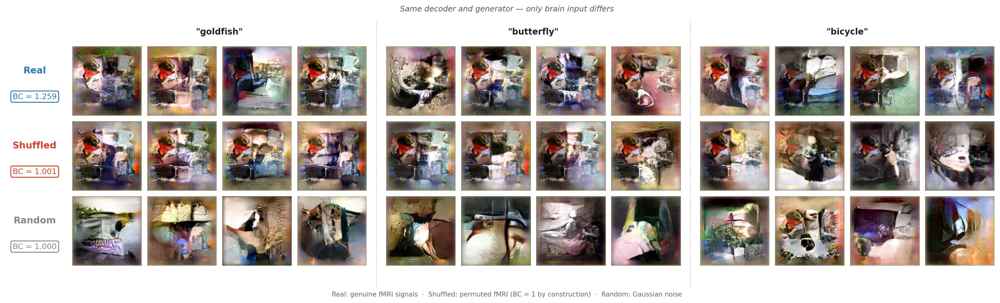
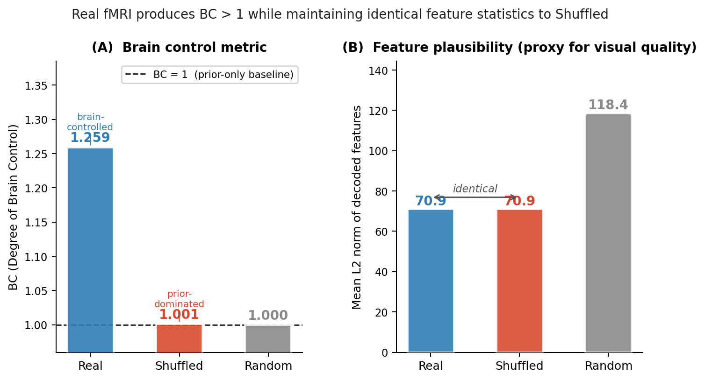
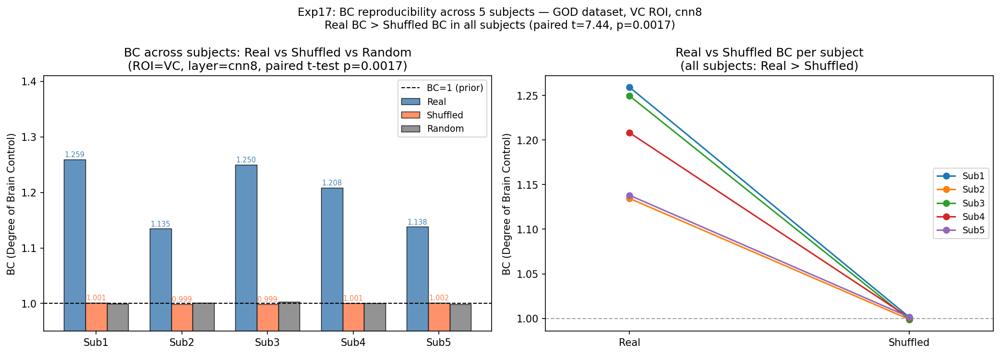
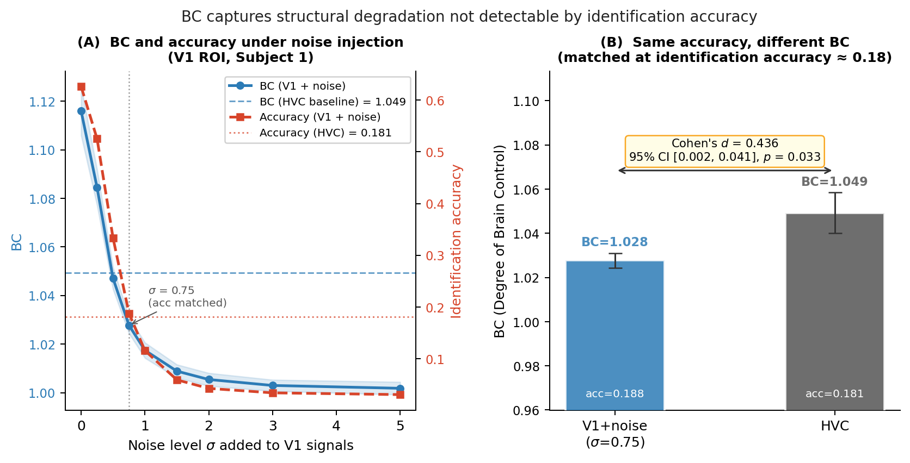
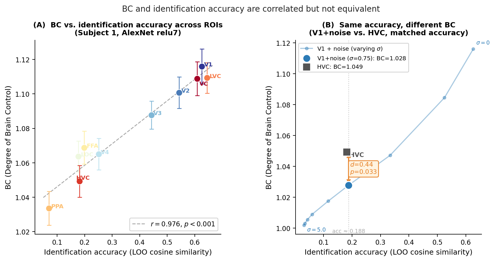
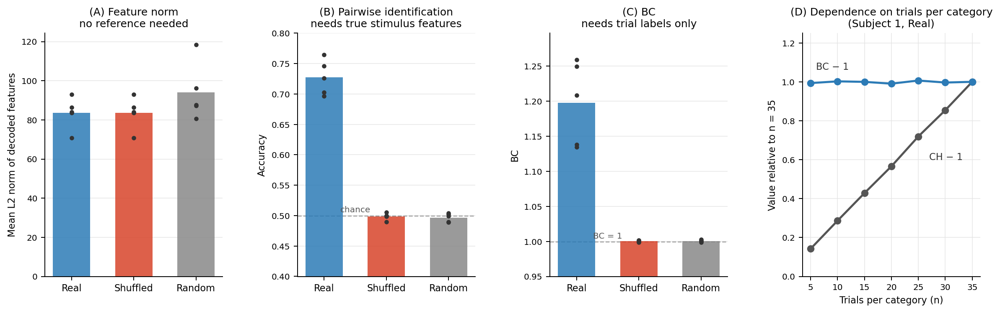

# Plausible but Not Brain-Driven

### Quantifying Prior Dominance in Neural Image Reconstruction

**Paper:** [PDF](paper/main.pdf) · [LaTeX source](paper/main.tex) · arXiv: coming soon

Can a brain-to-image reconstruction look correct even when the brain signal contains no meaningful information?

This repository introduces Brain Control (BC), a metric designed to quantify how much reconstructed images are actually driven by neural activity rather than by powerful generative priors.

Our key finding:

> A reconstruction pipeline can generate realistic, category-consistent images even when the underlying brain signals are completely randomized—and statistics that do not use the true stimulus cannot detect it.

<p align="center">

</p>

*Figure 1. The same decoder and generator receive real or shuffled fMRI. Both produce plausible images with identical feature statistics; BC separates them.*

---

## Why This Matters

Recent brain decoding systems can reconstruct visually impressive images from fMRI data using diffusion models, GANs, and large-scale visual priors.

However, visual realism does not necessarily imply neural control.

A reconstruction can appear successful because the generator already knows how to produce plausible natural images, regardless of whether the decoded brain activity contains stimulus-specific information.

This creates a fundamental evaluation problem (Subject 1):

| Condition | Visual Quality | Feature Norm | Identification Accuracy | BC |
|------------|---------------|-------------|-------------------------|------|
| Real fMRI | Plausible | 70.9 | **0.726** | **1.259** |
| Shuffled fMRI | Plausible | 70.9 | 0.500 | 1.001 |
| Gaussian Noise | Plausible | 118.4 | 0.490 | 1.000 |

Even after destroying all brain–stimulus correspondence by shuffling fMRI signals:

- reconstructed images remain visually plausible,
- decoded feature magnitudes remain unchanged (the shuffled set contains the same vectors in a different order),
- statistics that do not use the true stimulus show no sign of failure.

Identification accuracy does fall to chance (0.5), because it compares the output with the presented stimulus. Brain Control (BC) detects the failure as well, using only which trials share a stimulus, and reports it on a calibrated scale where BC = 1 means no brain information.

---

## The Brain Control (BC) Metric

BC measures how much structure disappears when the relationship between brain activity and stimulus labels is intentionally broken.

$$\mathrm{BC} = \frac{V_\text{brok}}{V_\text{pres}}$$

where:

- $V_\text{pres}$: within-category feature variance under preserved correspondence
- $V_\text{brok}$: expected variance after random shuffling of brain–stimulus mappings (estimated from 1,000 permutations)

### Interpretation

- BC = 1
  - Shuffling has no effect
  - Reconstruction is prior-dominated
  - Brain signals contribute little or no information

- BC > 1
  - Preserved correspondence reduces variance
  - Brain activity imposes meaningful structure
  - Reconstruction is genuinely brain-driven

Under a Gaussian approximation, applied per feature dimension $k$:

$$I(c;\hat{x}_k) \le \tfrac{1}{2}\log \mathrm{BC}_k$$

Thus:

- BC = 1 implies zero mutual information between category labels and decoded features.
- Larger BC values indicate stronger neural control.

The bound is nearly tight when BC is close to 1. The assumptions behind this and the other properties of BC are listed in the next section.

---

## Theoretical Assumptions

Notation: $N$ test trials, $C$ categories with $n$ trials each, $d$ feature dimensions. $SS_W$, $SS_B$ and $SS_T = SS_W + SS_B$ are the within-category, between-category and total sums of squares, summed over feature dimensions (traces of the scatter matrices).

| # | Assumption | Used for | Status in this study |
|---|------------|----------|----------------------|
| A1 | **Balanced design**: every category has the same number of trials $n$ | Closed form below; $V_\text{pres}$ equals the pooled within-category variance | Holds: GOD test set has 50 categories × 35 trials |
| A2 | **Exchangeability under the null**: if decoded features carry no category information, trials can be permuted without changing their distribution | $\mathbb{E}[\mathrm{BC}] \approx 1$ under the null; permutation p-value | Holds by construction for Shuffled and Random. Real fMRI trials are treated as independent; temporal autocorrelation and run effects are not modelled |
| A3 | **Variance is pooled across dimensions** (trace) | Reducing BC to one scalar | BC is invariant to global rescaling and rotations of feature space, but not to per-dimension rescaling: high-variance dimensions dominate. Reported values use decoded features in original `cnn8` units |
| A4 | **Gaussian class-conditionals with shared variance**, per dimension | Information-theoretic reading only | An approximation. Not needed for A1–A3 results |

**What BC estimates (needs A1 only).** The sample variance of a subset drawn without replacement is unbiased for the finite-population variance. The permutation expectation therefore has a closed form:

$$V_\text{brok} = \frac{SS_T}{d\,(N-1)}, \qquad V_\text{pres} = \frac{SS_W}{d\,(N-C)}$$

$$\mathrm{BC} = \frac{N-C}{N-1}\cdot\frac{SS_T}{SS_W} = 1 + \frac{C-1}{N-1}\,(F-1), \qquad F = \frac{SS_B/(C-1)}{SS_W/(N-C)}$$

$F$ is the one-way ANOVA $F$ statistic computed on traces, which is the Calinski–Harabasz index of the decoded features with categories as clusters. For Subject 1 (Real), the 1,000-permutation estimate is 1.2592 and the closed form gives 1.2591 ($F = 10.25$). The permutations are only needed for the p-value, not for BC itself.

Consequences:
- **Relation to SNR.** As $n \to \infty$, $\mathrm{BC} \to 1 + \operatorname{tr}\Sigma_B / \operatorname{tr}\Sigma_W$. In other words, $\mathrm{BC} \approx 1 + \mathrm{SNR}_\text{eff}$, where $\mathrm{SNR}_\text{eff}$ is the ratio of between-category to within-category variance in feature space. This needs no Gaussian assumption.
- **Effect size, not test statistic.** For a fixed effect, $F$ grows roughly in proportion to $n$, while $\mathrm{BC} - 1$ does not depend on $n$ (Finding 4). BC relates to $F$ the way an effect size relates to its test statistic.
- **Null value (A2).** Under the null, $V_\text{pres}$ and $V_\text{brok}$ estimate the same variance, so BC ≈ 1 up to sampling noise (Shuffled: 0.999–1.002 across subjects). BC ≈ 1 for Shuffled and Random is guaranteed by construction, so these conditions check calibration.
- **Information (A4).** For one dimension with Gaussian class-conditionals and shared variance, $I(c;\hat{x}_k) = h(\hat{x}_k) - h(\hat{x}_k \mid c) \le \tfrac12\log(\sigma_T^2/\sigma_W^2) = \tfrac12\log\mathrm{BC}_k$. This holds because a Gaussian has the largest entropy for a given variance. The bound is close to tight when $\sigma_B^2 \ll \sigma_W^2$, as here (BC ≈ 1.1–1.3). For the full $d$-dimensional vector the bound depends on $\det\Sigma_T / \det\Sigma_W$, not on traces. So $\tfrac12\log\mathrm{BC}$ should not be read as the mutual information of the whole feature vector.

Scope:
- **Category = stimulus in the GOD test set.** Each test category has a single image, so $V_\text{pres}$ is the variance across 35 repeated presentations of that image. On this dataset BC measures stimulus-specific consistency.
- **Feature space, not image space.** Phase-1 BC is computed on decoded features before they reach the generator, so the generator does not affect it. Generator effects appear only in Phase-2 BC (DreamSim embeddings of generated images; paper, Experiment 3).

---

## Dataset and Experimental Conditions

**Dataset: Generic Object Decoding (GOD)** ([Horikawa & Kamitani, 2017](https://doi.org/10.1038/ncomms15037); [data and code](https://github.com/KamitaniLab/GenericObjectDecoding))

| | |
|---|---|
| Subjects | 5 (Subject1–5) |
| Training data | 1,200 images, 1 presentation each → 1,200 samples |
| Test data | 50 images (1 per category) × 35 presentations → 1,750 samples |
| Imagery data | Not used |
| ROI | VC: 4,466 / 4,404 / 4,643 / 4,133 / 4,370 voxels (Subjects 1–5). Exp15 also uses V1, V2, V3, V4, LOC, FFA, PPA, LVC, HVC |

**Pipeline and hyperparameters**

| Setting | Main results (Exp13, 17, 18, 19) | BC vs. accuracy (Exp15, 16) | Reconstructed images (Fig. 1, 2) |
|---|---|---|---|
| Target features | `cnn8` from GOD `ImageFeatures.h5` (1,000 units) | AlexNet `relu7` (torchvision, ImageNet weights; 4,096 units) | AlexNet `relu7` (4,096 units) |
| Training images | All 1,200 | 733 of 1,200 (images available locally) | 733 of 1,200 |
| Decoder | Ridge, α = 100; brain and features z-scored with training-set statistics | Same | Same |
| Generator | — | — | `relu7generator` ([brain-decoding-cookbook](https://github.com/KamitaniLab/brain-decoding-cookbook-public), `fg_GOD`) |
| BC computed on | Decoded features, original units | Decoded features, original units | — |
| BC estimator | Pooled ratio, 1,000 permutations (`compute_bc.py`) | Mean of per-category ratios, 1,000 permutations | — |
| Accuracy metric | Pairwise identification against the true `cnn8` features of the 50 test images (Pearson correlation); chance = 0.5 | Top-1 nearest category mean (cosine, leave-one-out); chance = 2% | — |
| Random seed | 42 | 42 | 42 |

The BC values printed on Figures 1–3 come from the main `cnn8` pipeline (Exp13). The reconstructed images come from the separate `relu7` pipeline.

**Input conditions (Exp13, 17, 19)**
- **Real**: test fMRI samples paired with their stimuli.
- **Shuffled**: the 1,750 test samples are permuted once (seed 42) before decoding. The set of decoded vectors is the same as for Real; only their pairing with labels changes. Feature norms are therefore identical by construction.
- **Random**: test samples are replaced with i.i.d. N(0, 1) noise in z-scored voxel space.

**Statistics**
- Multi-subject replication: paired t-test of Real vs. Shuffled BC, n = 5 subjects (df = 4).
- Matched accuracy (Exp16): Gaussian noise (σ = 0.75) added to z-scored V1 signals; Welch's t-test on per-category BC values, V1+noise vs. HVC (50 categories each).
- Permutation p-value (`compute_bc.py`): one-sided, fraction of permutations with BC ≤ 1.
- Trials per category (Exp19): $n$ = 5–35 trials drawn per category, 20 draws per $n$ (Subject 1, Real).

**Software**: Python 3.10, NumPy 2.2, SciPy 1.15, scikit-learn 1.7, h5py 3.16, matplotlib 3.10. PyTorch 2.11 and torchvision 0.26 for `relu7` feature extraction.

---

## Main Findings

### 1. Prior dominance is invisible to statistics that do not use the true stimulus

Real fMRI:

- BC = 1.259

Shuffled fMRI:

- BC = 1.001

Yet decoded feature norms are identical, and the reconstructions look the same:

- Real: 70.9
- Shuffled: 70.9

This demonstrates a critical dissociation: statistics that do not use the true stimulus remain unchanged while neural control disappears.


*Figure 2. Reconstructions for Real, Shuffled and Random input (Subject 1, VC; 3 categories × 4 repetitions).*


*Figure 3. BC (left) and feature L2 norm (right) per condition. Real and Shuffled have identical norms but different BC.*

---

### 2. Replicates across all five subjects

| Subject | Real BC | Shuffled BC |
|----------|---------|-------------|
| 1 | 1.259 | 1.001 |
| 2 | 1.135 | 0.999 |
| 3 | 1.250 | 0.999 |
| 4 | 1.208 | 1.001 |
| 5 | 1.138 | 1.002 |

Paired t-test:

- t = 7.44
- p = 0.0017


*BC for Real, Shuffled and Random input in all five subjects (VC, `cnn8`).*

---

### 3. BC captures information beyond identification accuracy

Across ROIs (`relu7` features):

- Pearson r = 0.976 between BC and identification accuracy

However:

- matched-accuracy comparisons still show significant BC differences
- Cohen's d = 0.436
- p = 0.033

This indicates BC is not simply another accuracy metric.

Instead, it measures a distinct property:

how strongly brain activity constrains the reconstruction process.


*Figure 4. BC and accuracy as noise is added to V1 signals. BC degrades faster than accuracy.*


*Figure 5. (A) BC vs. identification accuracy across ten ROIs. (B) V1+noise and HVC have matched accuracy but different BC.*

---

### 4. Comparison with existing metrics

Mean over five subjects (range in brackets):

| Metric | Needs | Real | Shuffled | Random | Separates Real from Shuffled? |
|--------|-------|------|----------|--------|-------------------------------|
| Feature norm | Nothing | 83.5 [70.9, 92.9] | 83.5 [70.9, 92.9] | 94.0 [80.6, 118.4] | No (identical by construction) |
| Pairwise identification accuracy | True stimulus features | 0.727 [0.697, 0.764] | 0.499 [0.489, 0.505] | 0.497 [0.489, 0.504] | Yes |
| Calinski–Harabasz index (= ANOVA F) | Trial labels | 8.06 [5.80, 10.25] | 1.01 [0.95, 1.05] | 1.02 [0.95, 1.09] | Yes |
| BC | Trial labels | 1.198 [1.135, 1.259] | 1.000 [0.999, 1.002] | 1.000 [0.999, 1.003] | Yes |

BC and the Calinski–Harabasz index carry the same information. Across all 15 subject × condition cells, the 1,000-permutation BC matches the closed form $1 + (C-1)(\mathrm{CH}-1)/(N-1)$ to within 0.0002. They differ in scale: when the number of trials per category $n$ drops from 35 to 5, CH falls from 10.25 to 2.31, while BC stays between 1.257 and 1.261.


*Figure 6. (A–C) Feature norm, pairwise identification accuracy and BC for Real, Shuffled and Random input (bars: mean over five subjects; dots: subjects). (D) BC − 1 and CH − 1 as the number of trials per category varies, relative to n = 35 (Subject 1, Real).*

---

## What Is New

BC is not a new statistic. With the same number of trials per category, it is an affine function of the one-way ANOVA $F$ statistic, i.e. the Calinski–Harabasz index of the decoded features. What this work contributes is how that quantity is read and used:

- **A calibrated effect size.** BC = 1 means no brain information, and $\mathrm{BC} - 1 \approx$ the between- to within-stimulus variance ratio. Unlike $F$, it does not grow with the number of trials, so values can be compared across experiments with different numbers of repetitions (Finding 4).
- **A check for prior dominance.** Applied to decoded features with real vs. shuffled brain input, BC shows whether brain signals constrain the reconstruction or the prior does — a failure that reference-free statistics miss (Finding 1). It needs only which trials share a stimulus, not the stimulus' ground-truth representation.
- **Not redundant with identification accuracy.** Identification accuracy also detects shuffling, but conditions with matched accuracy can differ in BC, and BC keeps decreasing where accuracy saturates (Finding 3).

---

## Quick Start

### Installation

```bash
pip install numpy scipy scikit-learn matplotlib pillow h5py
# relu7 feature extraction and reconstruction export (Exp15, Exp16, Fig. 1, 2)
pip install torch torchvision hdf5storage
```

### Data

This project uses the [Generic Object Decoding (GOD) dataset](https://github.com/KamitaniLab/GenericObjectDecoding) and the [brain-decoding-cookbook](https://github.com/KamitaniLab/brain-decoding-cookbook-public) reconstructions.

Place data as follows:
```
data/god/
  Subject1.mat ... Subject5.mat     # fMRI data (GOD format)
  ImageFeatures.h5                  # GOD image features (cnn1–cnn8)
  images_train/  images_test/       # stimulus images (only for relu7 extraction)
  alexnet_features_{train,test}.npz # created by experiments/extract_alexnet_features.py
brain-decoding-cookbook-public/     # reconstruction images (tiff)
```

### Main Experiment

```bash
python experiments/exp13_prior_vs_brain.py
```

### Multi-Subject Replication

```bash
python experiments/exp17_multisubject_bc.py
```

### ROI Analysis

```bash
# relu7 features for Exp15 and Exp16 (run once)
python experiments/extract_alexnet_features.py
python experiments/exp15_roi_bc_vs_accuracy.py
```

### Same Accuracy, Different BC

```bash
python experiments/exp16_same_acc_diff_bc.py
```

### Comparison with Existing Metrics

```bash
python experiments/exp19_existing_metrics.py
```

### Paper Figures

```bash
python experiments/fig1_concept.py
python experiments/fig2_reconstruction_comparison.py
python experiments/fig3_bc_barplot.py
python experiments/fig4_noise_sensitivity.py
python experiments/fig5_bc_vs_accuracy.py
```

---

## Using BC on Your Own Decoding Results

```python
from compute_bc import compute_bc

# pred_features: (N_trials, N_features) array of decoded features
# cat_labels:    (N_trials,) array of integer category labels
bc_mean, bc_std, var_pres, var_brok_list, p_value = compute_bc(
    pred_features,
    cat_labels,
    n_shuffle=1000,
    seed=42,
    mode="across"
)

print(f"BC = {bc_mean:.4f} (SD over permutations {bc_std:.4f}), p = {p_value:.4f}")
```

Interpretation:
```text
BC ≈ 1.0   → Prior-dominated reconstruction
BC > 1.0   → Brain-driven reconstruction
```

---

## Repository Structure

```
compute_bc.py                  # Core BC computation
experiments/
  exp13_prior_vs_brain.py      # Main experiment: 3-condition comparison
  exp15_roi_bc_vs_accuracy.py  # BC vs. accuracy across ROIs
  exp16_same_acc_diff_bc.py    # Same accuracy, different BC
  exp17_multisubject_bc.py     # Multi-subject replication
  exp19_existing_metrics.py    # Comparison with existing metrics
  fig1_concept.py              # Paper Figure 1
  fig2_reconstruction_comparison.py
  fig3_bc_barplot.py
  fig4_noise_sensitivity.py
  fig5_bc_vs_accuracy.py
outputs/                       # Generated figures and saved results
paper/                         # Paper PDF, LaTeX source and figures
theory_bc_definition.md        # Mathematical definition and derivations
paper_outline.md               # Full paper draft
```

---

## Citation

```bibtex
@article{kikuchi2026bc,
  title   = {Plausible but Not Brain-Driven: Quantifying Prior Dominance
             in Neural Image Reconstruction},
  author  = {Kikuchi, Yuki},
  year    = {2026},
  note    = {Preprint}
}
```

*(arXiv link coming soon)*

---

## License

MIT License
