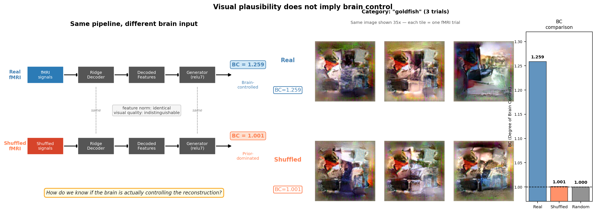

# Plausible but Not Brain-Driven

### Quantifying Prior Dominance in Neural Image Reconstruction

Can a brain-to-image reconstruction look correct even when the brain signal contains no meaningful information?

This repository introduces Brain Control (BC), a metric designed to quantify how much reconstructed images are actually driven by neural activity rather than by powerful generative priors.

Our key finding is striking:

> A modern reconstruction pipeline can generate realistic, category-consistent images even when the underlying brain signals are completely randomized—and standard evaluation metrics often fail to detect it.

<p align="center">

</p>

---

## Why This Matters

Recent brain decoding systems can reconstruct visually impressive images from fMRI data using diffusion models, GANs, and large-scale visual priors.

However, visual realism does not necessarily imply neural control.

A reconstruction can appear successful because the generator already knows how to produce plausible natural images, regardless of whether the decoded brain activity contains stimulus-specific information.

This creates a fundamental evaluation problem:

| Condition | BC | Feature Norm | Visual Quality |
|------------|------|-------------|---------------|
| Real fMRI | 1.259 | 70.9 | Plausible |
| Shuffled fMRI | 1.001 | 70.9 | Plausible |
| Gaussian Noise | 1.000 | 118.4 | Plausible |

Even after destroying all brain–stimulus correspondence by shuffling fMRI signals:

- reconstructed images remain visually plausible,
- decoded feature magnitudes remain unchanged,
- standard metrics show little indication of failure.

Brain Control (BC) detects this failure mode directly.

---

## The Brain Control (BC) Metric

BC measures how much structure disappears when the relationship between brain activity and stimulus labels is intentionally broken.

[
BC = \frac{V_{\text{brok}}}{V_{\text{pres}}}
]

where:

- (V_{\text{pres}}): within-category feature variance under preserved correspondence
- (V_{\text{brok}}): expected variance after random shuffling of brain–stimulus mappings

### Interpretation

- BC = 1
  - Shuffling has no effect
  - Reconstruction is prior-dominated
  - Brain signals contribute little or no information

- BC > 1
  - Preserved correspondence reduces variance
  - Brain activity imposes meaningful structure
  - Reconstruction is genuinely brain-driven

Under a Gaussian approximation:

[
I(c;\hat{x}) \approx \frac{1}{2}\log(BC)
]

Thus:

- BC = 1 implies approximately zero mutual information between category labels and decoded representations.
- Larger BC values indicate stronger neural control.

---

## Main Findings

### 1. Prior dominance is invisible to existing metrics

Real fMRI:

- BC = 1.259

Shuffled fMRI:

- BC = 1.001

Yet decoded feature norms are identical:

- Real: 70.9
- Shuffled: 70.9

This demonstrates a critical dissociation:

standard reconstruction statistics remain unchanged while neural control disappears.

---

### 2. Replicates across all five subjects

| Subject | Real BC | Shuffled BC |
|----------|---------|-------------|
| 1 | 1.259 | 1.001 |
| 2 | 1.135 | 0.999 |
| 3 | 1.250 | 0.999 |
| 4 | 1.208 | 1.001 |
| 5 | 1.138 | 1.002 |

Paired t-test:

- t = 7.44
- p = 0.0017

---

### 3. BC captures information beyond identification accuracy

Across ROIs:

- Pearson r = 0.967 between BC and identification accuracy

However:

- matched-accuracy comparisons still show significant BC differences
- Cohen's d = 0.465
- p = 0.023

This indicates BC is not simply another accuracy metric.

Instead, it measures a distinct property:

how strongly brain activity constrains the reconstruction process.

---

## Figures

| Figure | Description |
|----------|-------------|
| fig1_concept.png | Conceptual illustration of prior dominance |
| fig2_reconstruction_comparison.png | Real vs Shuffled vs Random reconstructions |
| fig3_bc_barplot.png | BC and feature norm comparison |
| fig4_noise_sensitivity.png | Noise sensitivity analysis |
| fig5_bc_vs_accuracy.png | BC vs identification accuracy |

---

## Quick Start

### Installation

```bash
pip install numpy scipy scikit-learn matplotlib pillow h5py
```

### Main Experiment

```bash
python experiments/exp13_prior_vs_brain.py
```

### Multi-Subject Replication

```bash
python experiments/exp17_multisubject_bc.py
```

### ROI Analysis

```bash
python experiments/exp15_roi_bc_vs_accuracy.py
```

---

## Using BC on Your Own Decoding Results

```python
from compute_bc import compute_bc

bc_mean, bc_sem, bc_per_cat = compute_bc(
    pred_features,
    cat_labels,
    n_shuffle=1000,
    seed=42,
    mode="across"
)

print(f"BC = {bc_mean:.4f} ± {bc_sem:.4f}")
```

Interpretation:
```text
BC ≈ 1.0   → Prior-dominated reconstruction
BC > 1.0   → Brain-driven reconstruction
```
---

## Citation

bibtex @article{kikuchi2026bc,   title={Plausible but Not Brain-Driven: Quantifying Prior Dominance in Neural Image Reconstruction},   author={Kikuchi, Yuki},   year={2026},   note={Preprint} } 

(arXiv link coming soon)

---

## License

MIT License
