# Stimulus-Specific Reliability and Sampling Variability

### in Single-Trial fMRI-to-Image Decoding

**Paper:** [PDF](paper/main.pdf) · [LaTeX source](paper/main.tex) · arXiv: coming soon

Brain-to-image decoders combine brain-derived features with strong generative priors and random sampling. A realistic reconstruction therefore does not show, by itself, how much of it was determined by brain activity.

This repository introduces the Degree of Brain Control (BC). BC measures how consistently a decoder turns repeated presentations of the same stimulus into the same output, on a calibrated scale where BC = 1 when the output carries no stimulus information. It is a multivariate reliability measure, an exact transform of the image intraclass correlation coefficient (I2C2; [Shou et al., 2013](https://doi.org/10.3758/s13415-013-0196-0)). BC shows whether stimulus-specific structure reaches the output; it does not show how much of an image comes from the brain rather than from the generative prior.

Key findings:

- **GOD (controlled inputs).** BC separates real from shuffled fMRI input (1.259 vs. 1.001, Subject 1), although the decoded features have identical norms and the reconstructions look equally plausible.
- **NSD (current decoders).** Single-trial reconstructions of MindEye2, MindEye1 and Brain-Diffuser all have BC well above 1 (1.25–1.87; shuffled controls 0.99–1.01; MindEye2 in four subjects, the others in subject 1). All show reproducible, stimulus-specific variation at the single-trial level.
- **Where the structure comes from.** In MindEye2 (subject 1), about 45% of the final-image BC excess (DreamSim) is explained by 40 semantic clusters. 55–63% of the within-stimulus variance of a single reconstruction comes from the diffusion seed.
- **Relation to identification accuracy.** BC ranks the four NSD decoders in the same order as pairwise identification accuracy, but spaces them differently. BC is a calibrated, stage-wise diagnostic, not a replacement for identification accuracy.

<p align="center">
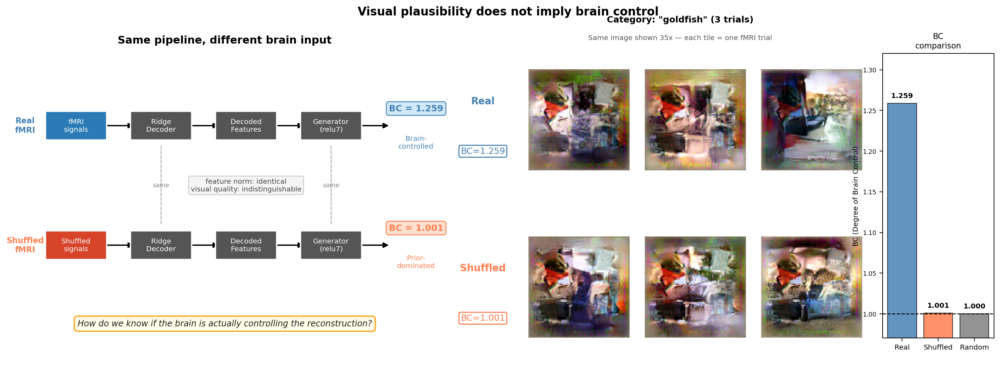
</p>

*Figure 1. On GOD, the same decoder and generator receive real or shuffled fMRI. Both produce similar-looking images with identical feature statistics. BC computed on the decoded `cnn8` features separates them; the images come from a separate `relu7` pipeline. In those generated images, per-category image-space BC averages 1.036; because the two values come from different decoders, this shows that consistency found with a feature decoder has to be checked directly in the final images, not how much of it passes from features to images.*

---

## Why This Matters

Visual realism does not necessarily imply neural control. A reconstruction can look successful because the generator already knows how to produce plausible natural images, whether or not the decoded brain activity contains stimulus-specific information.

This creates an evaluation problem (GOD, Subject 1):

| Condition | Visual Quality | Feature Norm | Identification Accuracy | BC |
|------------|---------------|-------------|-------------------------|------|
| Real fMRI | Plausible | 70.9 | **0.726** | **1.259** |
| Shuffled fMRI | Plausible | 70.9 | 0.500 | 1.001 |
| Gaussian Noise | Plausible | 118.4 | 0.490 | 1.000 |

Even after destroying all brain–stimulus correspondence by shuffling fMRI signals:

- reconstructed images remain visually plausible,
- decoded feature magnitudes remain unchanged (the shuffled set contains the same vectors in a different order),
- statistics that do not use the true stimulus show no sign of failure.

Identification accuracy does fall to chance (0.5), because it compares the output with the presented stimulus. BC detects the failure as well, using only which trials share a stimulus, and reports it on a calibrated scale with a null value of 1.

The same question matters for current diffusion-based decoders, where the prior is far stronger and every run of the sampler produces a different image. The NSD experiments below measure it there.

---

## The Brain Control (BC) Metric

BC measures how much structure disappears when the relationship between brain activity and stimulus labels is intentionally broken.

$$\mathrm{BC} = \frac{V_\text{brok}}{V_\text{pres}}$$

where:

- $V_\text{pres}$: within-stimulus variance of the decoder outputs under preserved correspondence
- $V_\text{brok}$: expected within-stimulus variance after randomly shuffling the brain–stimulus pairing (closed form below, or 1,000 permutations)

### Interpretation

- BC = 1
  - Shuffling has no effect
  - The mean output does not differ between stimuli; the output's structure comes from the prior or from sampling
- BC > 1
  - Trials of the same stimulus give more similar outputs than randomly paired trials
  - Brain activity imposes consistent, stimulus-specific structure on the output

BC measures **consistency, not correctness or provenance**. A decoder that turns every presentation of a stimulus into the same wrong image has high BC. A decoder that reads only the category from the brain and then outputs a fixed prototype image of that category also has very high BC, although the generator supplies every detail. Report BC together with a reference-based measure such as identification accuracy.

The converse of "no stimulus information ⇒ BC = 1" does not hold in general: BC captures differences in the mean output between stimuli, so information carried only by the spread or shape of the output distribution leaves BC at 1.

BC is a variance ratio, not a percentage. BC = 1.87 means stimulus-driven variance is about 0.87 times the within-stimulus variance (ICC ≈ 0.46). It does not mean that 87% of the image comes from the brain.

Under a Gaussian approximation, applied per output dimension $k$:

$$I(s;\hat{x}_k) \le \tfrac{1}{2}\log \mathrm{BC}_k$$

So BC = 1 implies zero mutual information between the stimulus label and that dimension. The assumptions behind this and the other properties of BC are listed in the next section.

---

## Theoretical Assumptions

Notation: $N$ trials, $C$ stimuli with $n$ trials each, $d$ output dimensions. $SS_W$, $SS_B$ and $SS_T = SS_W + SS_B$ are the within-stimulus, between-stimulus and total sums of squares, summed over dimensions (traces of the scatter matrices).

| # | Assumption | Used for | Status in this study |
|---|------------|----------|----------------------|
| A1 | **Balanced design**: every stimulus has the same number of trials $n$ | Closed form below; $V_\text{pres}$ equals the pooled within-stimulus variance | Holds: GOD test set has 50 stimuli × 35 trials; every NSD image analyzed has 3 trials |
| A2 | **Exchangeability under the null**: if outputs carry no stimulus information, trials can be permuted without changing their distribution | $\mathbb{E}[\mathrm{BC}] \approx 1$ under the null; permutation p-value | Holds by construction for Shuffled and Random. Real fMRI trials are treated as independent; temporal autocorrelation, run and session effects are not modelled |
| A3 | **Variance is pooled across dimensions** (trace) | Reducing BC to one scalar | BC is invariant to global rescaling and rotations of the output space, but not to per-dimension rescaling: high-variance dimensions dominate. Reported values use outputs in their original units |
| A4 | **Gaussian class-conditionals with shared variance**, per dimension | Information-theoretic reading only | An approximation. Not needed for A1–A3 results |

**What BC estimates (needs A1 only).** The sample variance of a subset drawn without replacement is unbiased for the finite-population variance. The permutation expectation therefore has a closed form:

$$V_\text{brok} = \frac{SS_T}{d\,(N-1)}, \qquad V_\text{pres} = \frac{SS_W}{d\,(N-C)}$$

$$\mathrm{BC} = \frac{N-C}{N-1}\cdot\frac{SS_T}{SS_W} = 1 + \frac{C-1}{N-1}\,(F-1), \qquad F = \frac{SS_B/(C-1)}{SS_W/(N-C)}$$

$F$ is the one-way ANOVA $F$ statistic computed on traces, which is the Calinski–Harabasz index of the outputs with stimuli as clusters. For GOD Subject 1 (Real), the 1,000-permutation estimate is 1.2592 and the closed form gives 1.2591 ($F = 10.25$). The permutations are only needed for the p-value, not for BC itself.

Consequences:
- **Relation to the ICC.** With variance components $\sigma_w^2 = SS_W/(N-C)$ and $\sigma_s^2 = (SS_B/(C-1) - \sigma_w^2)/n$, $\mathrm{BC} = 1 + \frac{n(C-1)}{N-1}\,\sigma_s^2/\sigma_w^2 \approx 1/(1-\mathrm{ICC})$. The factor $n(C-1)/(N-1)$ is 0.999 for $C = 500$, $n = 3$. This needs no Gaussian assumption.
- **Relation to I2C2.** The method-of-moments estimator of the image intraclass correlation coefficient ([Shou et al., 2013](https://doi.org/10.3758/s13415-013-0196-0)) estimates $\mathrm{tr}K_W$ by $SS_T/(N-1)$ and $\mathrm{tr}K_U$ by $SS_W/(N-C)$, so with stimuli in place of subjects $\mathrm{BC} = 1/(1-\hat\rho_\mathrm{I2C2})$ exactly.
- **Effect size, not test statistic.** For a fixed effect, $F$ grows roughly in proportion to $n$, while $\mathrm{BC} - 1$ does not depend on $n$ (Finding 3). BC relates to $F$ the way an effect size relates to its test statistic.
- **Null value (A2).** Under the null, $V_\text{pres}$ and $V_\text{brok}$ estimate the same variance, so BC ≈ 1 up to sampling noise (GOD Shuffled: 0.999–1.002 across subjects; NSD shuffled labels: 0.986–1.024 across all stages, subjects and image sets). These conditions check calibration.
- **Information (A4).** For one dimension with Gaussian class-conditionals and shared variance, $I(s;\hat{x}_k) = h(\hat{x}_k) - h(\hat{x}_k \mid s) \le \tfrac12\log(\sigma_T^2/\sigma_W^2) = \tfrac12\log\mathrm{BC}_k$. This holds because a Gaussian has the largest entropy for a given variance. For the full $d$-dimensional vector the bound depends on $\det\Sigma_T / \det\Sigma_W$, not on traces. So $\tfrac12\log\mathrm{BC}$ should not be read as the mutual information of the whole output vector.

Scope:
- **Stimulus = category in the GOD test set.** Each test category has a single image, so $V_\text{pres}$ is the variance across 35 repeated presentations of that image. In NSD the unit is the individual image.
- **Any stage of a pipeline.** BC needs only trial labels, so it can be computed on decoded features, intermediate latents (e.g. a diffusion prior's output) or embeddings of the final images.

**Two decompositions for generative decoders** (NSD experiments):
- **Category-controlled BC.** Stimuli are grouped into semantic clusters (k-means on CLIP embeddings of the ground-truth images). A nested ANOVA gives $\mathrm{BC}_\text{beyond} = 1 + \frac{n(C-1)}{N-1}\,\sigma_{s|g}^2/\sigma_w^2$, the BC left once the cluster of the stimulus is known. Category share $= (\mathrm{BC} - \mathrm{BC}_\text{beyond})/(\mathrm{BC} - 1)$.
- **Seed decomposition.** Each trial is generated with $R$ seeds. A nested ANOVA (stimulus > trial > seed) gives $\mathrm{BC}(k) = 1 + \frac{n(C-1)}{N-1}\,\sigma_a^2/(\sigma_b^2 + \sigma_e^2/k)$ for outputs averaged over $k$ seeds. BC(1) is the usual single-sample value; BC(∞) removes sampling variability. Sampling share $= \sigma_e^2/(\sigma_b^2 + \sigma_e^2)$.

---

## Datasets and Experimental Conditions

### GOD: controlled inputs

**Dataset: Generic Object Decoding (GOD)** ([Horikawa & Kamitani, 2017](https://doi.org/10.1038/ncomms15037); [data and code](https://github.com/KamitaniLab/GenericObjectDecoding))

| | |
|---|---|
| Subjects | 5 (Subject1–5) |
| Training data | 1,200 images, 1 presentation each → 1,200 samples |
| Test data | 50 images (1 per category) × 35 presentations → 1,750 samples |
| Imagery data | Not used |
| ROI | VC: 4,466 / 4,404 / 4,643 / 4,133 / 4,370 voxels (Subjects 1–5). Exp15 also uses V1, V2, V3, V4, LOC, FFA, PPA, LVC, HVC |

**Pipeline and hyperparameters**

| Setting | Main results (Exp13, 17, 18, 19) | BC vs. accuracy (Exp15, 16) | Reconstructed images (Fig. 1, 2) |
|---|---|---|---|
| Target features | `cnn8` from GOD `ImageFeatures.h5` (1,000 units) | AlexNet `relu7` (torchvision, ImageNet weights; 4,096 units) | AlexNet `relu7` (4,096 units) |
| Training images | All 1,200 | 733 of 1,200 (images available locally) | 733 of 1,200 |
| Decoder | Ridge, α = 100; brain and features z-scored with training-set statistics | Same | Same |
| Generator | — | — | `relu7generator` ([brain-decoding-cookbook](https://github.com/KamitaniLab/brain-decoding-cookbook-public), `fg_GOD`) |
| BC computed on | Decoded features, original units | Decoded features, original units | — |
| BC estimator | Pooled ratio, 1,000 permutations (`compute_bc.py`) | Mean of per-category ratios, 1,000 permutations | — |
| Accuracy metric | Pairwise identification against the true `cnn8` features of the 50 test images (Pearson correlation); chance = 0.5 | Top-1 nearest category mean (cosine, leave-one-out); chance = 2% | — |
| Random seed | 42 | 42 | 42 |

The BC values printed on Figures 1–3 come from the main `cnn8` pipeline (Exp13). The reconstructed images come from the separate `relu7` pipeline.

**Input conditions (Exp13, 17, 19)**
- **Real**: test fMRI samples paired with their stimuli.
- **Shuffled**: the 1,750 test samples are permuted once (seed 42) before decoding. The set of decoded vectors is the same as for Real; only their pairing with labels changes. Feature norms are therefore identical by construction.
- **Random**: test samples are replaced with i.i.d. N(0, 1) noise in z-scored voxel space.

**Statistics**
- Multi-subject replication: paired t-test of Real vs. Shuffled BC, n = 5 subjects (df = 4).
- Matched accuracy (Exp16): Gaussian noise (σ = 0.75) added to z-scored V1 signals; Welch's t-test on per-category BC values, V1+noise vs. HVC (50 categories each).
- Permutation p-value (`compute_bc.py`): one-sided, fraction of permutations with BC ≤ 1.
- Trials per category (Exp19): $n$ = 5–35 trials drawn per category, 20 draws per $n$ (Subject 1, Real).

**Software**: Python 3.10, NumPy 2.2, SciPy 1.15, scikit-learn 1.7, h5py 3.16, matplotlib 3.10. PyTorch 2.11 and torchvision 0.26 for `relu7` feature extraction.

### NSD: current decoders on single trials

**Dataset: Natural Scenes Dataset (NSD)** ([Allen et al., 2022](https://naturalscenesdataset.org/)). We use the shared test images, each viewed three times by each subject. Every analysis uses single-trial responses; the three trials are never averaged. This repository does not contain NSD brain data, stimulus images or reconstructions.

| | |
|---|---|
| MindEye2 (Exp20–22) | Public models for subjects 1, 2, 5, 7. Both are fine-tuned after shared-subject pretraining, on all 40 sessions (**40sess**) or 1 session (**1sess**) of the subject's data |
| Stages | **S0** ridge output (4,096 dims) · **S1** backbone output (256 × 1,664) · **S2** diffusion prior output (256 × 1,664) · **S3** final unCLIP image (256 × 256, no refinement), embedded with DreamSim (1,792 dims) and CLIP ViT-L/14 (768 dims). S1 and S2 also as the mean over 256 tokens |
| MindEye1 and Brain-Diffuser (Exp23) | Subject 1. MindEye1 with its public weights. Brain-Diffuser's regression weights are not public, so its ridge regressions were retrained on the original training data (8,859 images with their trials averaged, as in the original code; 15,724 voxels). Test images: the 839 of the original 982 that have three trials in the publicly released sessions 1–37 used by the original code |
| Sampling | One image per trial with a fixed per-trial seed; no best-of-n selection (MindEye1 originally picks the best of 16 samples) |
| Stimuli | Fixed random order (seed 42). MindEye2: S0–S2 computed on all 1,000 shared images, S3 on the first 500 (same for all subjects); results are reported on these 500 unless stated otherwise. Method comparison: 414 images common to all methods |
| Category analysis (Exp20b) | k-means on CLIP embeddings of the 1,000 ground-truth images; k = 40 (10 and 100 as checks) |
| Seed analysis (Exp21) | 4 seeds per trial; S2 on 1,000 images, S3 on 100 |
| Statistics | Closed-form BC; shuffled-label control; stimulus-level bootstrap (1,000 resamples, paired across models, bias-corrected percentile intervals); pairwise identification against ground-truth embeddings (chance = 0.5) |
| Reproduction checks | MindEye2: for 10 test images per subject, the closest published reconstruction (CLIP) was that of the same image. MindEye1 / Brain-Diffuser: 3-trial averages of 100 images reached 94.6% / 92.6% CLIP two-way identification (reported on the full test sets: 94.6% / 92.5%; the comparison is approximate) |
| Implementation | Official CUDA code ported to PyTorch's MPS backend on macOS (float16 autocast, attention without xformers, VAE decoding in float32). MindEye2 checkpoints loaded with strict key matching; for MindEye1 and Brain-Diffuser, no missing or unexpected weights (verified) |
| CLIP embedder | OpenAI ViT-L/14 weights with QuickGELU, the activation they were trained with. The first subject-1 analysis used standard GELU by mistake; this was noticed from a library warning after that analysis and all CLIP embeddings were recomputed |

Predictions and analysis plans were written down in advance: for the MindEye2 experiments before the images were generated, for the category analysis before it was run. For the method comparison no predictions about differences between methods were made; the thresholds of its two checks were fixed after generation but before the results were examined. These plans were not externally registered. The full record, including failed predictions, is in [`results.md`](results.md) (in Japanese).

---

## Main Findings

### GOD

#### 1. Prior dominance is invisible to statistics that do not use the true stimulus

Real fMRI:

- BC = 1.259

Shuffled fMRI:

- BC = 1.001

Yet decoded feature norms are identical, and the reconstructions look the same:

- Real: 70.9
- Shuffled: 70.9

Statistics that do not use the true stimulus remain unchanged while neural control disappears.

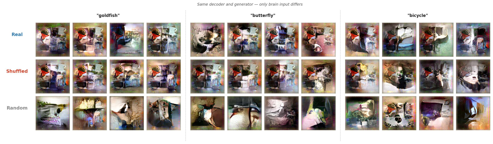
*Figure 2. Reconstructions for Real, Shuffled and Random input (Subject 1, VC; 3 categories × 4 repetitions).*

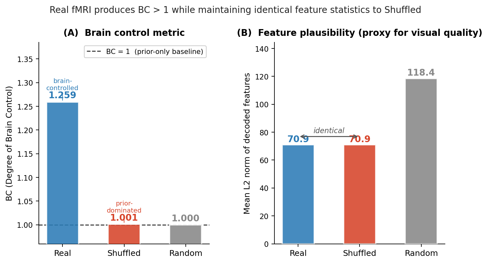
*Figure 3. BC (left) and feature L2 norm (right) per condition. Real and Shuffled have identical norms but different BC.*

#### 2. Replicates across all five subjects

| Subject | Real BC | Shuffled BC |
|----------|---------|-------------|
| 1 | 1.259 | 1.001 |
| 2 | 1.135 | 0.999 |
| 3 | 1.250 | 0.999 |
| 4 | 1.208 | 1.001 |
| 5 | 1.138 | 1.002 |

Paired t-test: t = 7.44, p = 0.0017.

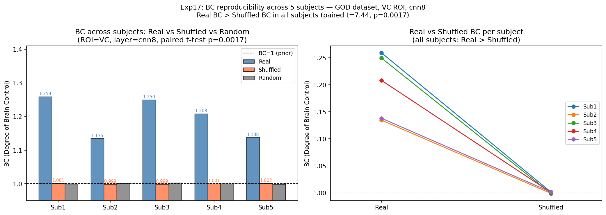
*BC for Real, Shuffled and Random input in all five subjects (VC, `cnn8`).*

#### 3. Comparison with existing metrics

Mean over five subjects (range in brackets):

| Metric | Needs | Real | Shuffled | Random | Separates Real from Shuffled? |
|--------|-------|------|----------|--------|-------------------------------|
| Feature norm | Nothing | 83.5 [70.9, 92.9] | 83.5 [70.9, 92.9] | 94.0 [80.6, 118.4] | No (identical by construction) |
| Pairwise identification accuracy | True stimulus features | 0.727 [0.697, 0.764] | 0.499 [0.489, 0.505] | 0.497 [0.489, 0.504] | Yes |
| Calinski–Harabasz index (= ANOVA F) | Trial labels | 8.06 [5.80, 10.25] | 1.01 [0.95, 1.05] | 1.02 [0.95, 1.09] | Yes |
| BC | Trial labels | 1.198 [1.135, 1.259] | 1.000 [0.999, 1.002] | 1.000 [0.999, 1.003] | Yes |

BC and the Calinski–Harabasz index carry the same information. Across all 15 subject × condition cells, the 1,000-permutation BC matches the closed form $1 + (C-1)(\mathrm{CH}-1)/(N-1)$ to within 0.0002. They differ in scale: when the number of trials per category $n$ drops from 35 to 5, CH falls from 10.25 to 2.31, while BC stays between 1.257 and 1.261.

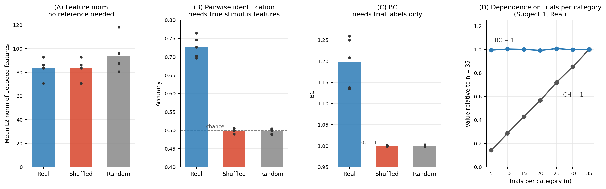
*Figure 4. (A–C) Feature norm, pairwise identification accuracy and BC for Real, Shuffled and Random input (bars: mean over five subjects; dots: subjects). (D) BC − 1 and CH − 1 as the number of trials per category varies, relative to n = 35 (Subject 1, Real).*

#### 4. BC and identification accuracy across ROIs

Across ten ROIs (`relu7` features), BC and identification accuracy are highly correlated (Pearson r = 0.976). In an exploratory check, noise was added to V1 until its accuracy matched HVC; BC then differed slightly (Cohen's d = 0.436, p = 0.033). The noise level was chosen after the fact and the effect is small, so this is a weak indication, not evidence that BC measures something identification accuracy cannot.

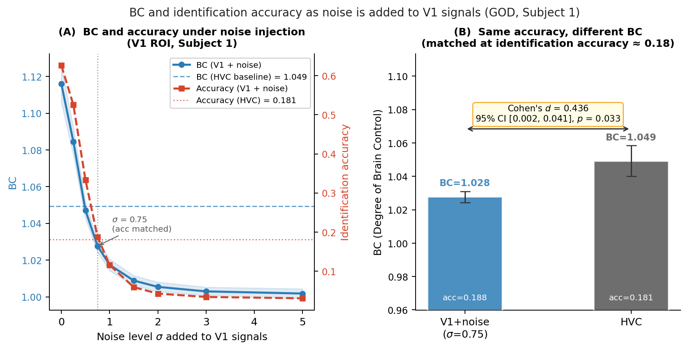
*Figure 5. BC and accuracy as noise is added to V1 signals, with HVC baselines.*

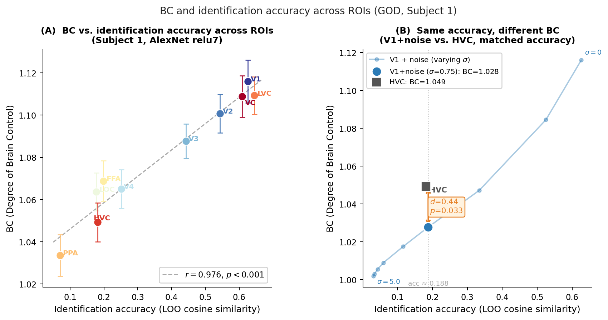
*Figure 6. (A) BC vs. identification accuracy across ten ROIs. (B) V1+noise and HVC have matched accuracy but slightly different BC.*

### NSD

#### 5. Single-trial reconstructions of MindEye2 show stimulus-specific consistency

Final-image BC (DreamSim, 500 images, 95% CI):

| Subject | 40sess | 1sess | Identification, DreamSim (40sess / 1sess) |
|---|---|---|---|
| 1 | 1.867 [1.818, 1.916] | 1.483 [1.449, 1.518] | 0.982 / 0.902 |
| 2 | 1.829 [1.782, 1.877] | 1.421 [1.394, 1.451] | 0.977 / 0.879 |
| 5 | 1.867 [1.823, 1.917] | 1.454 [1.425, 1.488] | 0.986 / 0.904 |
| 7 | 1.509 [1.475, 1.543] | 1.246 [1.226, 1.267] | 0.953 / 0.819 |

- BC is well above 1 in every subject and for both models; shuffled controls stay at 1 (0.986–1.009).
- Less subject-specific training data (1sess) lowers final-image BC in every subject (+0.26 to +0.41). At the ridge stage (S0) the difference is small or absent; it appears from the backbone (S1) on.
- With token means, BC decreases from the backbone to the prior to the final image in every subject. Because BC depends on the representation, this describes consistency in each representation and does not by itself locate where stimulus information is lost.

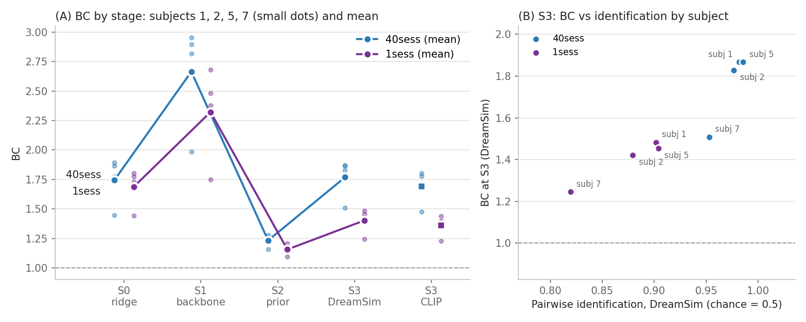
*Figure 7. (A) BC at each MindEye2 stage for subjects 1, 2, 5, 7 (small dots) and their mean. (B) Final-image BC against pairwise identification accuracy.*

#### 6. About 45% of the final-image BC excess is explained by semantic clusters

With 40 semantic clusters (subject 1), BC beyond category stays clearly above 1 at every stage (final image, DreamSim: 1.47 for 40sess, 1.27 for 1sess; lower CI bound > 1.12 for every stage, model and k). The clusters explain 44–46% of the final-image excess over 1 in DreamSim space (48–55% for CLIP embeddings, the space in which the clusters were defined), against 19–33% at the ridge and backbone stages. The share depends on how categories are defined (it grows with k). BC beyond category > 1 shows consistency that this clustering does not explain; finer semantic distinctions within clusters may account for part of it. BC does not test generalization to categories absent from training.

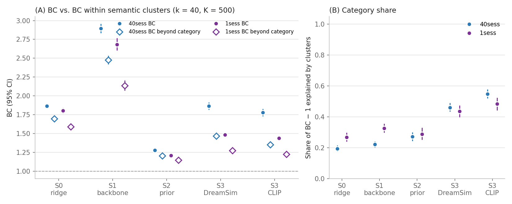
*Figure 8. (A) BC and BC beyond category (k = 40) at each MindEye2 stage, subject 1. (B) Share of BC − 1 explained by the clusters.*

#### 7. More than half of the within-stimulus variance of one image comes from the seed

With 4 seeds per trial (subject 1, 100 images), the sampling share at the final image is 0.55–0.63 for both models. BC from one sample per trial therefore captures only 37–45% of the excess over 1 that remains when sampling is removed (DreamSim, 40sess: BC(1) = 1.84, BC(∞) = 2.92). The sampling share is the same for both models, so the lower BC of 1sess is not due to a larger share of sampling noise.

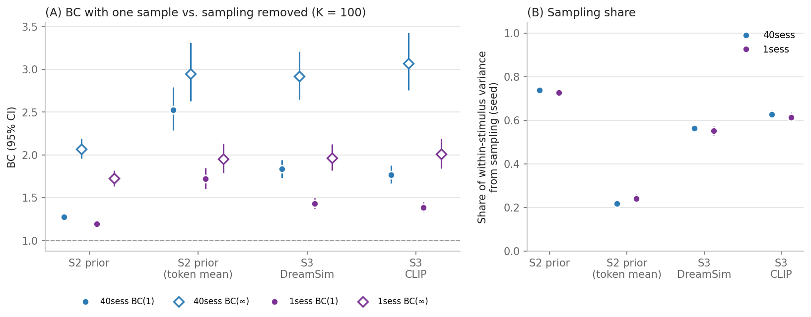
*Figure 9. (A) BC(1) and BC(∞) for MindEye2, subject 1. (B) Share of within-stimulus variance from the sampling seed.*

#### 8. MindEye2, MindEye1 and Brain-Diffuser: same ranking as identification accuracy

Subject 1, 414 common images:

| Method | BC, DreamSim | BC, CLIP | Identification, DreamSim | Identification, CLIP |
|---|---|---|---|---|
| MindEye2 40sess | 1.856 [1.802, 1.910] | 1.777 [1.726, 1.831] | 0.981 | 0.916 |
| MindEye1 | 1.661 [1.617, 1.708] | 1.653 [1.605, 1.704] | 0.968 | 0.903 |
| Brain-Diffuser | 1.533 [1.502, 1.563] | 1.504 [1.474, 1.534] | 0.957 | 0.875 |
| MindEye2 1sess | 1.470 [1.435, 1.508] | 1.425 [1.389, 1.460] | 0.901 | 0.765 |

- All methods have final-image BC well above 1: they show stimulus-specific consistency at the single-trial level.
- BC and identification accuracy give the same ranking, and all six pairwise differences exclude 0 for both. Across subjects, the only disagreements concern subjects 1 and 5, whose values are close on both measures (differences ≤ 0.04 in BC and ≤ 0.02 in identification accuracy).
- They space the decoders differently (exploratory). MindEye2 40sess and MindEye1 differ by 1.3 points of identification accuracy but by 0.195 in BC; Brain-Diffuser and MindEye2 1sess differ by 5.6 points but by only 0.063 in BC.

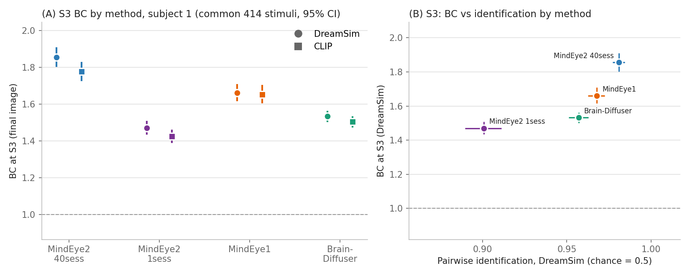
*Figure 10. (A) Final-image BC of four decoders, subject 1. (B) BC against pairwise identification accuracy.*

---

## What Is New

BC is not a new statistic. With the same number of trials per stimulus, it is an affine function of the one-way ANOVA $F$ statistic (the Calinski–Harabasz index) and approximately $1/(1-\mathrm{ICC})$, and an exact transform of the I2C2 estimate. What this work contributes is how that reliability measure is applied to generative decoders:

- **A calibrated effect size.** BC = 1 when the output carries no stimulus information, and $\mathrm{BC} - 1 \approx$ the ratio of stimulus-driven to within-stimulus variance. Unlike $F$, it does not grow with the number of trials, so values obtained with different numbers of repetitions can be compared, provided the stimuli and representation are the same (Finding 3).
- **A label-only, stage-wise diagnostic.** BC needs only which trials share a stimulus, so it can be computed at every stage of a pipeline, including stages without a ground-truth target (Findings 1, 5).
- **Decompositions for generative decoders.** Category-controlled BC and the seed decomposition separate the consistency explained by semantic clusters, the rest, and sampling-driven variability (Findings 6, 7).
- **An audit of current decoders.** Single-trial reconstructions of MindEye2, MindEye1 and Brain-Diffuser show stimulus-specific consistency; its degree differs between decoders and training regimes (Findings 5–8).

BC does not replace identification accuracy. In all our comparisons it ranks decoders in the same order (Finding 8).

---

## Quick Start

### Installation

```bash
pip install numpy scipy scikit-learn matplotlib pillow h5py
# relu7 feature extraction and reconstruction export (Exp15, Exp16, Fig. 1, 2)
pip install torch torchvision hdf5storage
```

### Data

This project uses the [Generic Object Decoding (GOD) dataset](https://github.com/KamitaniLab/GenericObjectDecoding) and the [brain-decoding-cookbook](https://github.com/KamitaniLab/brain-decoding-cookbook-public) reconstructions.

Place data as follows:
```
data/god/
  Subject1.mat ... Subject5.mat     # fMRI data (GOD format)
  ImageFeatures.h5                  # GOD image features (cnn1–cnn8)
  images_train/  images_test/       # stimulus images (only for relu7 extraction)
  alexnet_features_{train,test}.npz # created by experiments/extract_alexnet_features.py
brain-decoding-cookbook-public/     # reconstruction images (tiff)
```

### Main Experiment

```bash
python experiments/exp13_prior_vs_brain.py
```

### Multi-Subject Replication

```bash
python experiments/exp17_multisubject_bc.py
```

### ROI Analysis

```bash
# relu7 features for Exp15 and Exp16 (run once)
python experiments/extract_alexnet_features.py
python experiments/exp15_roi_bc_vs_accuracy.py
```

### Same Accuracy, Different BC

```bash
python experiments/exp16_same_acc_diff_bc.py
```

### Comparison with Existing Metrics

```bash
python experiments/exp19_existing_metrics.py
```

### NSD Experiments (Exp20–23)

The inference scripts need the original decoder code, models and NSD data, which are not in this repository. They expect a working directory `$EXP20` (default `~/exp20`) containing a clone of [MindEyeV2](https://github.com/MedARC-AI/MindEyeV2) with its `fmri` environment and data, and, for Exp23, MindEye1 and [Brain-Diffuser](https://github.com/ozcelikfu/brain-diffuser) with their weights. Setup details and options are in the docstring at the top of each script (in Japanese).

```bash
# Inference (GPU; outputs go to $EXP20, outside the repository)
bash experiments/exp20_run.sh main          # MindEye2, subject 1, S0–S3
bash experiments/exp21_run.sh main          # extra seeds for the seed decomposition
bash experiments/exp22_run.sh 2 main        # subjects 2, 5, 7
bash experiments/exp23_run.sh bd_cpu        # Brain-Diffuser regressions (CPU), then `me1` / `bd` modes

# Analysis (CPU)
python experiments/exp20_mindeye2_bc.py
python experiments/exp20b_beyond_category.py
python experiments/exp21_seed_decomposition.py
python experiments/exp22_multisubject_bc.py   # --plot_only redraws the figure from the saved npz
python experiments/exp23_methods_bc.py        # --plot_only redraws the figure from the saved npz
```

### Paper Figures

```bash
python experiments/fig1_concept.py
python experiments/fig2_reconstruction_comparison.py
python experiments/fig3_bc_barplot.py
python experiments/fig4_noise_sensitivity.py
python experiments/fig5_bc_vs_accuracy.py
python experiments/exp18_prior_strength.py --plot_only   # Fig. 9 of the paper, from the saved npz
```

The paper is built with `tectonic paper/main.tex`. The figures in `paper/` are copies of figures in `outputs/` (e.g. `fig8_nsd_stages.png` = `outputs/exp22_multisubject_bc.png`).

---

## Using BC on Your Own Decoding Results

```python
from compute_bc import compute_bc

# pred_features: (N_trials, N_features) array of decoder outputs
# cat_labels:    (N_trials,) array of integer stimulus labels
bc_mean, bc_std, var_pres, var_brok_list, p_value = compute_bc(
    pred_features,
    cat_labels,
    n_shuffle=1000,
    seed=42,
    mode="across"
)

print(f"BC = {bc_mean:.4f} (SD over permutations {bc_std:.4f}), p = {p_value:.4f}")
```

With the same number of trials per stimulus, BC can also be computed directly with the closed form $\mathrm{BC} = \frac{N-C}{N-1}\cdot\frac{SS_T}{SS_W}$.

Interpretation:
```text
BC ≈ 1.0   → No mean-level stimulus dependence detected in this representation
BC > 1.0   → Brain activity imposes consistent, stimulus-specific structure
```

---

## Repository Structure

```
compute_bc.py                  # Core BC computation
experiments/
  exp13_prior_vs_brain.py      # GOD main experiment: 3-condition comparison
  exp15_roi_bc_vs_accuracy.py  # GOD: BC vs. accuracy across ROIs
  exp16_same_acc_diff_bc.py    # GOD: same accuracy, different BC
  exp17_multisubject_bc.py     # GOD: multi-subject replication
  exp19_existing_metrics.py    # GOD: comparison with existing metrics
  exp20_*.py, exp20_run.sh     # NSD: MindEye2 per-trial inference and stage-wise BC (subject 1)
  exp20b_beyond_category.py    # NSD: category-controlled BC
  exp21_*.py, exp21_run.sh     # NSD: seed decomposition
  exp22_*.py, exp22_run.sh     # NSD: subjects 2, 5, 7
  exp23_*.py, exp23_run.sh     # NSD: MindEye1 and Brain-Diffuser
  fig1_concept.py              # Paper Figure 1
  fig2_reconstruction_comparison.py
  fig3_bc_barplot.py
  fig4_noise_sensitivity.py
  fig5_bc_vs_accuracy.py
outputs/                       # Generated figures and aggregated results
paper/                         # Paper PDF, LaTeX source and figures
results.md                     # Experiment log with all results and predictions (Japanese)
theory_bc_definition.md        # Mathematical definition and derivations
paper_outline.md               # Earlier paper outline
```

---

## Citation

```bibtex
@article{kikuchi2026bc,
  title   = {Stimulus-Specific Reliability and Sampling Variability
             in Single-Trial fMRI-to-Image Decoding},
  author  = {Kikuchi, Yuki},
  year    = {2026},
  note    = {Preprint}
}
```

*(arXiv link coming soon)*

---

## License

MIT License
