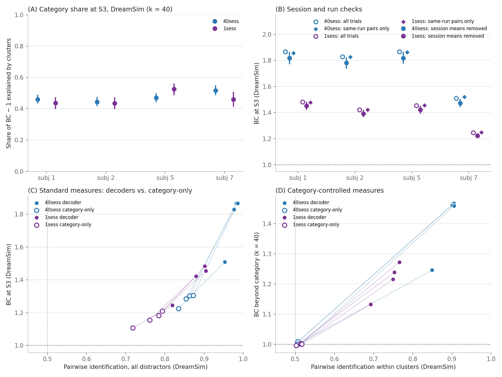

# Stimulus-Specific Reliability and Sampling Variability in Single-Trial fMRI-to-Image Decoding

**Paper:** [PDF](paper/main.pdf) · [LaTeX source](paper/main.tex) · arXiv: coming soon

Brain-to-image decoders combine brain-derived features with strong generative priors and random sampling, so a realistic reconstruction does not show by itself whether brain activity shaped it. This repository measures the **Degree of Brain Control (BC)**: how consistently a decoder turns repeated presentations of the same stimulus into the same output. BC is a multivariate reliability measure. It shows whether stimulus-specific structure reaches the output; it does not show how much of an image comes from the brain rather than from the prior.

## Key results

- **GOD (controlled inputs).** On decoded features, BC separates real from shuffled fMRI input (1.259 vs. 1.001, Subject 1), although the feature norms are identical and the reconstructions look alike.
- **NSD (current decoders, single trials).** Final images of MindEye2 (four subjects), MindEye1 and Brain-Diffuser (subject 1) all have BC well above 1 (1.25–1.87; shuffled controls ≈ 1). Removing session effects or comparing only trials from the same run changes BC little.
- **Category.** 40 semantic clusters explain 43–53% of the final-image BC excess (MindEye2, four subjects). A category-only version of each decoder still reaches BC up to 1.30 and pairwise identification up to 0.87; only category-controlled BC and within-cluster identification separate it from the decoder.
- **Sampling.** 55–63% of the within-stimulus variance of a single reconstruction comes from the diffusion seed (MindEye2, subject 1).
- **Relation to identification accuracy.** BC ranks decoders in the same order as pairwise identification accuracy. It complements identification accuracy rather than replacing it.


*(A) Share of BC − 1 explained by semantic clusters. (B) BC with session means removed and from same-run pairs only. (C, D) Decoders (filled) vs. their category-only versions (open): standard measures cannot tell them apart; category-controlled measures can.*

## The measure

For outputs of $N$ trials of $C$ stimuli ($n$ trials each), BC is the ratio of the within-stimulus variance when the trial–stimulus pairing is shuffled to the same variance when it is preserved. With equal trials per stimulus it has a closed form:

$$\mathrm{BC} = \frac{N-C}{N-1}\cdot\frac{SS_T}{SS_W} = 1 + \frac{C-1}{N-1}\,(F-1)$$

where $SS_T$ and $SS_W$ are the total and within-stimulus sums of squares (summed over dimensions) and $F$ is the one-way ANOVA $F$ statistic. BC equals $1/(1-\hat\rho)$ for the method-of-moments estimate $\hat\rho$ of the image intraclass correlation coefficient (I2C2; [Shou et al., 2013](https://doi.org/10.3758/s13415-013-0196-0)) and approximately $1/(1-\mathrm{ICC})$. Unlike $F$, it does not grow with the number of trials.

- **BC ≈ 1**: the mean output does not differ between stimuli in this representation.
- **BC > 1**: trials of the same stimulus give more similar outputs than randomly paired trials; stimulus-specific structure reaches the output through the brain signal.
- **What BC does not measure**: whether the output is correct (a decoder that is consistently wrong has high BC) or how much of it comes from the prior (a decoder that reads only the category and outputs a fixed prototype image has very high BC). Report it with identification accuracy and with category-controlled measures.

Derivations, the category-controlled and seed decompositions, and all results are in the [paper](paper/main.pdf). The full experiment log, including the predictions written before each analysis and the ones that failed, is in [`results.md`](results.md) (in Japanese).

## Using BC on your own decoding results

```python
from compute_bc import compute_bc

# pred_features: (N_trials, N_features) array of decoder outputs
# cat_labels:    (N_trials,) array of integer stimulus labels
bc_mean, bc_std, var_pres, var_brok_list, p_value = compute_bc(
    pred_features, cat_labels, n_shuffle=1000, seed=42, mode="across"
)
print(f"BC = {bc_mean:.4f}, p = {p_value:.4f}")
```

With the same number of trials per stimulus, the closed form above gives the same value without permutations.

## Reproducing the experiments

```bash
pip install numpy scipy scikit-learn matplotlib pillow h5py
pip install torch torchvision hdf5storage   # relu7 features and GOD figures
```

**GOD (Exp13–19).** Uses the [Generic Object Decoding dataset](https://github.com/KamitaniLab/GenericObjectDecoding) and [brain-decoding-cookbook](https://github.com/KamitaniLab/brain-decoding-cookbook-public) reconstructions, placed as follows:

```
data/god/
  Subject1.mat ... Subject5.mat     # fMRI data (GOD format)
  ImageFeatures.h5                  # GOD image features (cnn1–cnn8)
  images_train/  images_test/       # stimulus images (only for relu7 extraction)
brain-decoding-cookbook-public/     # reconstruction images (tiff)
```

```bash
python experiments/exp13_prior_vs_brain.py        # Real / Shuffled / Random
python experiments/exp17_multisubject_bc.py       # five subjects
python experiments/extract_alexnet_features.py    # relu7 features (once)
python experiments/exp15_roi_bc_vs_accuracy.py    # ROIs
python experiments/exp16_same_acc_diff_bc.py      # matched accuracy
python experiments/exp18_prior_strength.py        # mixing real and shuffled features
python experiments/exp19_existing_metrics.py      # comparison with existing metrics
```

**NSD (Exp20–24).** Needs the original decoder code, weights and NSD data, which are not in this repository. The scripts expect a working directory `$EXP20` (default `~/exp20`) with a clone of [MindEyeV2](https://github.com/MedARC-AI/MindEyeV2) and its `fmri` environment and data, and, for Exp23, MindEye1 and [Brain-Diffuser](https://github.com/ozcelikfu/brain-diffuser). Setup details are in the docstring at the top of each script (in Japanese). This repository contains only aggregated results, not NSD brain data, stimulus images or reconstructions.

```bash
bash experiments/exp20_run.sh main                # MindEye2 inference, subject 1 (GPU)
bash experiments/exp21_run.sh main                # extra seeds
bash experiments/exp22_run.sh 2 main              # subjects 2, 5, 7
bash experiments/exp23_run.sh bd_cpu              # Brain-Diffuser regressions, then the me1 / bd modes
python experiments/exp20_mindeye2_bc.py           # analyses (CPU)
python experiments/exp20b_beyond_category.py
python experiments/exp21_seed_decomposition.py
python experiments/exp22_multisubject_bc.py
python experiments/exp23_methods_bc.py
python experiments/exp24_robustness.py            # category in four subjects, session/run checks, category-only control
python experiments/exp24_robustness.py --run_matched
```

**Paper.** `tectonic paper/main.tex`. The figures in `paper/` are copies of figures in `outputs/`.

## Repository structure

```
compute_bc.py       # BC with permutations and p-value
experiments/        # one script per experiment (exp13–exp24) and figure scripts
outputs/            # figures and aggregated results (npz)
paper/              # paper source, figures and PDF
results.md          # experiment log with predictions and results (Japanese)
```

## Citation

```bibtex
@article{kikuchi2026bc,
  title   = {Stimulus-Specific Reliability and Sampling Variability
             in Single-Trial fMRI-to-Image Decoding},
  author  = {Kikuchi, Yuki},
  year    = {2026},
  note    = {Preprint}
}
```

## License

MIT License
