# Brain Control (BC) 実験ログ

## 概要

fMRI脳活動から画像特徴量をデコードし、Degree of Brain Control (BC) を測定する。

```
BC = Var(broken) / Var(preserved)

Var(preserved) = 同カテゴリの試行内での特徴量の分散（カテゴリ内 trial-to-trial variability）
Var(broken)    = 試行インデックスをシャッフルした後の「カテゴリスロット」内の分散の期待値

BC = 1  → ランダム摂動と正しい対応付けで分散が同じ → 脳活動の情報は特徴量に伝わっていない
BC > 1  → 正しい対応付けのときのほうが分散が小さい → 脳が再構成をある程度制御している
```

**情報理論的解釈**: ガウス近似下で、特徴量の各次元 $k$ について $I(c; \hat{x}_k) \le \frac{1}{2} \log \text{BC}_k$（BC が 1 に近いときほぼ等号）
→ BC = 1 は相互情報量ゼロ（情報なし）、BC > 1 はカテゴリ情報の保持を示す。

詳細な理論定義: `theory_bc_definition.md`

- **データ**: GOD (Generic Object Decoding) dataset
- **被験者**: Subject1（Exp17・19 は Subject1〜5）
- **デコーダ**: Ridge regression (alpha=100)
- **特徴量**: GOD の ImageFeatures.h5（cnn1〜cnn8, 主に cnn8 = 1000次元; Exp1〜10・12・13・17〜19）／ AlexNet relu7（fc7, 4096次元, Exp11・14〜16）
- **シャッフル回数**: 1000（最終版）

---

## Experiment 1: VC × cnn8（2026-04-09）

**設定**
- ROI: VC（視覚野全体, 4466 voxels）
- 特徴量: cnn8（AlexNet-like の最終 FC 層, 1000 units）
- Train: 1200 trials, Test: 1750 trials (50 categories × 35 reps)

**結果**
| 指標 | 値 |
|---|---|
| Decoding accuracy (mean r) | 0.2299 |
| Var (preserved) | 0.365793 |
| Var (broken) | 0.455081 ± 0.000775 |
| **BC** | **1.2441 ± 0.0021** |
| Effective Dimensionality (ED) | 11.74 |

**解釈**
- BC = 1.24：脳活動のシャッフルで変動が約24%増加 → 脳活動はある程度特徴量を制御しているが強くはない
- ED = 11.74：1000次元中、実質的に使われているのは約12次元（低次元collapse）

---

## Experiment 2: ROI比較 × cnn8（2026-04-09）

> この実験の結果は Experiment 3 に統合されています。

---

## Experiment 3: 全ROI × 全層（cnn1〜cnn8）比較（2026-04-09）

**設定**: Subject1, Ridge (alpha=100), 50 shuffles, 全ROI × cnn1〜cnn8

### BC ヒートマップ（行=層, 列=ROI）

|      | V1     | V2     | V3     | V4     | LOC    | FFA    | PPA    | LVC    | HVC    | VC     |
|------|--------|--------|--------|--------|--------|--------|--------|--------|--------|--------|
| cnn1 | 1.0947 | 1.0732 | 1.0542 | 1.0300 | 1.0228 | 1.0261 | 1.0131 | 1.0764 | 1.0175 | 1.0603 |
| cnn2 | 1.1779 | 1.1398 | 1.1065 | 1.0622 | 1.0366 | 1.0448 | 1.0226 | 1.1446 | 1.0339 | 1.1183 |
| cnn3 | 1.1804 | 1.1541 | 1.1157 | 1.0762 | 1.0582 | 1.0623 | 1.0342 | 1.1547 | 1.0442 | 1.1356 |
| cnn4 | 1.1775 | 1.1521 | 1.1176 | 1.0761 | 1.0628 | 1.0655 | 1.0329 | 1.1527 | 1.0449 | 1.1326 |
| cnn5 | 1.1663 | 1.1379 | 1.1099 | 1.0735 | 1.0606 | 1.0643 | 1.0327 | 1.1411 | 1.0445 | 1.1260 |
| cnn6 | 1.1619 | 1.1419 | 1.1311 | 1.1215 | 1.1278 | 1.1339 | 1.0667 | 1.1486 | 1.0907 | 1.1579 |
| cnn7 | 1.1379 | 1.1182 | 1.1108 | 1.1014 | 1.1161 | 1.1239 | 1.0599 | 1.1273 | 1.0837 | 1.1398 |
| cnn8 | 1.1472 | 1.1389 | 1.1559 | 1.1969 | **1.2265** | **1.2292** | 1.1255 | 1.1647 | 1.1732 | **1.2441** |

### ED ヒートマップ（行=層, 列=ROI）

|      | V1   | V2   | V3   | V4   | LOC  | FFA  | PPA  | LVC  | HVC  | VC   |
|------|------|------|------|------|------|------|------|------|------|------|
| cnn1 | 71.3 | 76.5 | 70.4 | 70.0 | 67.3 | 63.9 | 58.6 | 85.4 | 83.4 | 86.0 |
| cnn2 | 49.5 | 59.4 | 51.9 | 56.0 | 53.0 | 46.6 | 46.1 | 68.2 | 65.6 | 71.3 |
| cnn3 | 54.6 | 60.9 | 50.9 | 52.4 | 44.7 | 40.6 | 37.5 | 70.1 | 59.9 | 68.4 |
| cnn4 | 58.2 | 63.9 | 53.3 | 55.6 | 48.4 | 42.3 | 41.8 | 73.7 | 64.1 | 72.9 |
| cnn5 | 62.7 | 68.4 | 55.8 | 56.5 | 51.2 | 47.7 | 45.5 | 77.4 | 72.2 | 76.9 |
| cnn6 | 37.5 | 35.6 | 29.4 | 28.4 | 23.1 | 22.4 | 22.7 | 39.9 | 36.3 | 39.0 |
| cnn7 | 21.3 | 17.9 | 18.9 | 18.2 | 16.4 | 14.4 | 14.0 | 22.2 | 19.6 | 19.3 |
| cnn8 | 12.5 | 12.6 |  9.8 |  8.7 |  7.2 |  7.5 |  6.9 | 13.0 | 11.2 | 11.7 |

### 主要な発見

**BCのパターン**
- **V1×cnn2〜cnn3 で BC が最大（1.18）**: 低次視覚野は中間層特徴量を最も強く制御
- **LOC・FFA×cnn8 で BC が高い（1.23）**: 高次視覚野は最終分類層を制御
- **cnn1 では全ROIで BC が低い（1.01〜1.09）**: 最低次特徴は脳から制御しにくい
- **PPA は全層で BC が最低**: シーン特化領域はオブジェクト分類特徴との相性が悪い

**BC × ED の対角パターン（スライド Table 4 との照合）**
- 低次ROI（V1,V2）× 低次層（cnn2〜3）: BC高 + ED高 → 「Brain-driven, diverse outputs」
- 高次ROI（LOC,FFA）× 高次層（cnn8）: BC高 + ED低 → 「Low-dim but causally effective」

**EDのパターン**
- 層が深くなるほど ED が急減（cnn1: ~80 → cnn8: ~10）
- cnn6 で急激に落ちる（~40）→ FC 層への移行で semantic clustering が起きている

---

## Experiment 4: 全被験者 × 全ROI × 全層（2026-04-09）

**設定**: Subject1〜5, Ridge (alpha=100), 50 shuffles (across-category), 全ROI × cnn1〜cnn8

> within-category シャッフルは GOD データ（1カテゴリ=1画像×35反復）では数学的に BC=1.0 になるため不適。across のみ使用。

### VC × cnn8 の被験者間比較

| Subject | mean_r | BC | ± | ED |
|---|---|---|---|---|
| Subject1 | 0.2299 | 1.2441 | 0.0021 | 11.74 |
| Subject2 | 0.1898 | 1.1266 | 0.0020 | 13.14 |
| Subject3 | 0.2438 | 1.2347 | 0.0016 | 13.60 |
| Subject4 | 0.2209 | 1.1967 | 0.0020 | 13.77 |
| Subject5 | 0.1860 | 1.1328 | 0.0014 | 14.53 |
| **平均** | **0.2141** | **1.1870** | | **13.36** |

### BC × 被験者のパターン

- Subject1, Subject3 が高い BC（1.23〜1.24）
- Subject2, Subject5 が低い BC（1.13）
- **個人差が存在するが、全員 BC > 1** → 脳活動がデコードに影響しているのは再現性あり

### 層別 BC（VC ROI, 被験者平均）

| Layer | S1 | S2 | S3 | S4 | S5 | 平均 |
|---|---|---|---|---|---|---|
| cnn1 | 1.060 | 1.026 | 1.051 | 1.050 | 1.031 | **1.044** |
| cnn2 | 1.118 | 1.048 | 1.095 | 1.091 | 1.057 | **1.082** |
| cnn3 | 1.136 | 1.059 | 1.112 | 1.104 | 1.065 | **1.095** |
| cnn4 | 1.133 | 1.060 | 1.109 | 1.103 | 1.063 | **1.093** |
| cnn5 | 1.126 | 1.056 | 1.103 | 1.096 | 1.061 | **1.088** |
| cnn6 | 1.158 | 1.079 | 1.139 | 1.124 | 1.079 | **1.116** |
| cnn7 | 1.140 | 1.081 | 1.133 | 1.120 | 1.071 | **1.109** |
| cnn8 | 1.244 | 1.127 | 1.235 | 1.197 | 1.133 | **1.187** |

### 主要な発見

- **cnn8（最終FC層）で BC が最大**：全被験者で一貫して高い → 高次意味特徴が最も脳に制御されている
- **cnn1 で BC が最低**：低次視覚特徴（エッジ等）は脳から制御しにくい
- **被験者間で BC の絶対値は異なるが、層のパターンは一致** → 指標の信頼性を示唆
- **Subject2, Subject5 は全体的に BC が低い** → デコード精度（mean_r）も低く、voxel 数や個人差が影響している可能性

---

## Experiment 5: 統計的有意性検定（2026-04-09）

**設定**: N_SHUFFLE=1000, 片側パーミュテーション検定（帰無仮説: BC=1）
- p値 = シャッフル1000回中 BC≤1 になる割合

**結果**: **全400条件（5被験者 × 10ROI × 8層）で p < 0.001**

つまり1000回のシャッフルで一度も BC≤1 にならなかった。

**解釈**
- BC > 1 は全条件で統計的に有意（p < 0.001）
- 「脳活動がデコード出力を制御している」という効果は偶然ではない
- ただし BC の絶対値は 1.01〜1.24 の範囲であり、効果量としては小〜中程度
- 有意性が示されたことで、次の問い「BCはデコーダー精度の言い換えに過ぎないか」への検討に進める

---

## Experiment 6: BC vs デコーダー精度（mean_r）の関係（2026-04-09）

**設定**: 全400条件（5被験者 × 10ROI × 8層）の mean_r と BC_mean の相関分析

**結果**

| 対象 | Pearson r | p値 |
|---|---|---|
| 全400条件 | 0.853 | 1.20e-114 |
| cnn1 | 0.923 | <0.001 |
| cnn2 | 0.937 | <0.001 |
| cnn3 | 0.922 | <0.001 |
| cnn4 | 0.917 | <0.001 |
| cnn5 | 0.896 | <0.001 |
| cnn6 | 0.678 | <0.001 |
| cnn7 | 0.570 | <0.001 |
| cnn8 | 0.764 | <0.001 |

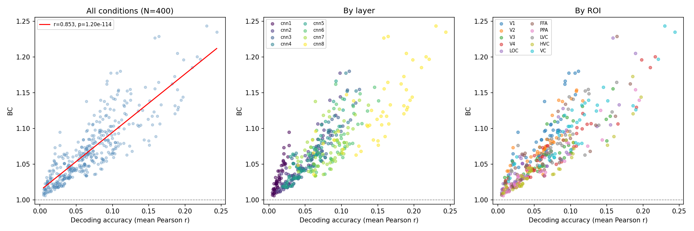

**解釈**

- 全体では r=0.85 と強い相関 → BC は精度と無関係ではない
- ただし **cnn6〜cnn7 で相関が落ちる**（r=0.57〜0.68）
  → FC 層への移行あたりで「精度が同じでも BC が異なる」条件が出現
- 散布図（層別）では、**同じ mean_r でも層によって BC が異なる**ことが視覚的に確認できる
  → BC は精度の完全な言い換えではなく、層（特徴量の抽象度）に依存した独立な情報を含む

**論文への示唆**

BC は デコーダー精度と相関するが同一ではない。特に高次FC層（cnn6〜7）においてBCが精度から乖離する傾向があり、これは「どの表現空間でデコードするか」がBCに独立した影響を持つことを示している。

---

## Experiment 7: カテゴリ別 BC（2026-04-09）

**設定**: Subject1, ROI_VC, cnn8, N_SHUFFLE=1000

### 結果（上位・下位）

| Rank | Category | BC |
|---|---|---|
| 1 | butterfly | 1.4789 |
| 2 | whistle | 1.4094 |
| 3 | knot | 1.4092 |
| 4 | fly | 1.4001 |
| 5 | bicycle | 1.3990 |
| ... | ... | ... |
| 46 | cannon | 1.1040 |
| 47 | snowplow | 1.0822 |
| 48 | ski | 1.0671 |
| 49 | airliner | 1.0277 |
| 50 | bullet train | 1.0217 |

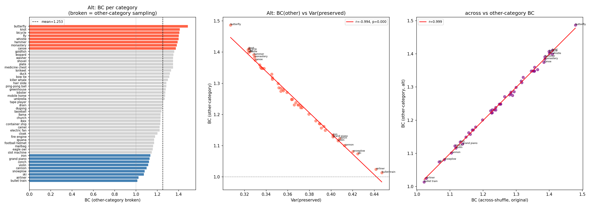

### 重要な発見：BC と Var(preserved) の相関 r = -0.995

**BC_cat ∝ 1 / Var(preserved, cat)** という関係が成立している。

**なぜか：**
```
BC_cat = Var(broken, cat) / Var(preserved, cat)
```
across-category シャッフル後の Var(broken, cat) は、全カテゴリで同じ値（全試行の平均的分散）に収束する。そのため BC_cat は実質的に Var(preserved, cat) の逆数になる。

**結論：カテゴリ別BCはBCの定義上の限界を示している。**
- **全体BC**（50カテゴリ平均）→ preserved全体 vs broken全体の比較として有意義
- **カテゴリ別BC** → broken分散が定数なため、preserved分散のランキングにすぎない。独立した情報を持たない。

**論文への示唆**：across-category シャッフルを用いたカテゴリ別BCの比較は意味をなさない。カテゴリ別の比較が必要な場合は、broken条件の設計を変える必要がある（例: カテゴリ別に「他カテゴリからランダムサンプリング」など）。

### 案1（other-category broken）の検証結果

`compute_bc_per_category_other` を実装し、各カテゴリの broken 条件を「他カテゴリからのランダムサンプリング」に変更したが、改善されなかった。

- [across] BC vs Var(pres): r = **-0.995**
- [other]  BC vs Var(pres): r = **-0.994**（ほぼ変わらず）

**なぜ改善されないか：**
各カテゴリの broken_other のプールは他49カテゴリ × 35試行 = 1715試行。これだけ大きなプールからサンプリングすると、大数の法則で Var(broken_other, cat) ≈ const に収束する。除外する35試行（全体の2%）の影響は無視できる。

**根本的な問題：** ランダムサンプリング系のアプローチは、サンプリング元が大きい限り同じ問題が再発する。かつ GOD のテストセットは1カテゴリ1画像×35リピートのため、カテゴリ内多様性がそもそも存在しない。カテゴリ別BCの設計自体を見直す必要がある。

---

## Experiment 8: BC × ED 合同分析（2026-04-09）

**設定**: Subject1, 全ROI × cnn1〜cnn8, N_SHUFFLE=1000

### 層軌跡（ROI平均）

| Layer | mean_BC | mean_ED |
|-------|---------|---------|
| cnn1 | 1.0469 | 73.29 |
| cnn2 | 1.0888 | 56.74 |
| cnn3 | 1.1016 | 54.00 |
| cnn4 | 1.1015 | 57.41 |
| cnn5 | 1.0957 | 61.42 |
| cnn6 | 1.1282 | 31.43 |
| cnn7 | 1.1119 | 18.23 |
| cnn8 | 1.1801 | 10.10 |

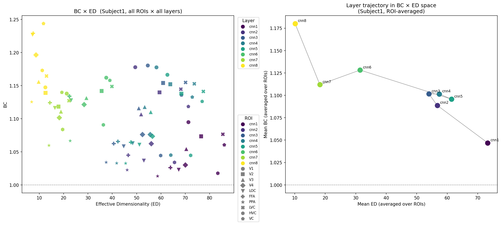

### 主要な発見

- **BC と ED は逆方向に動く**：層が深いほど ED が下がり BC が上がる
- **cnn2〜5 で BC がプラトー**（1.09〜1.10）しながら ED は変動 → conv 層内では BC と ED が独立に動く局面がある
- **cnn6 で ED が急落**（54→31）するタイミングで BC が跳ね上がる → FC 層への移行が BC を駆動している可能性
- **cnn8 が BC 最大・ED 最小**（BC=1.18, ED=10）：最も意味的に圧縮された表現空間で脳制御が最大化

---

## Experiment 9: BC vs mean_r 残差分析（2026-04-09）

**設定**: 全400条件（5被験者 × 10ROI × 8層）, 全体線形回帰の残差を分析

### 全体回帰

```
BC = 0.8165 × mean_r + 1.0130   (r = 0.853, p = 1.20e-114)
残差: mean = 0.000, std = 0.023
```

### 層別 平均残差

| Layer | mean_resid | 解釈 |
|-------|-----------|------|
| cnn1 | **+0.0074** | 精度のわりにBCが高い |
| cnn2〜5 | +0.001〜+0.005 | ほぼ回帰線上 |
| cnn6〜7 | -0.0050 | 精度のわりにBCがやや低い |
| cnn8 | **-0.0083** | 精度のわりにBCが最も低い |

### ROI別 平均残差

| ROI | mean_resid | 解釈 |
|-----|-----------|------|
| V1 | **+0.0283** | 精度以上にBCが高い |
| V2 | +0.0126 | |
| V4 | -0.0066 | |
| PPA | -0.0139 | 精度のわりにBCが低い |
| HVC | **-0.0183** | 最も低い |

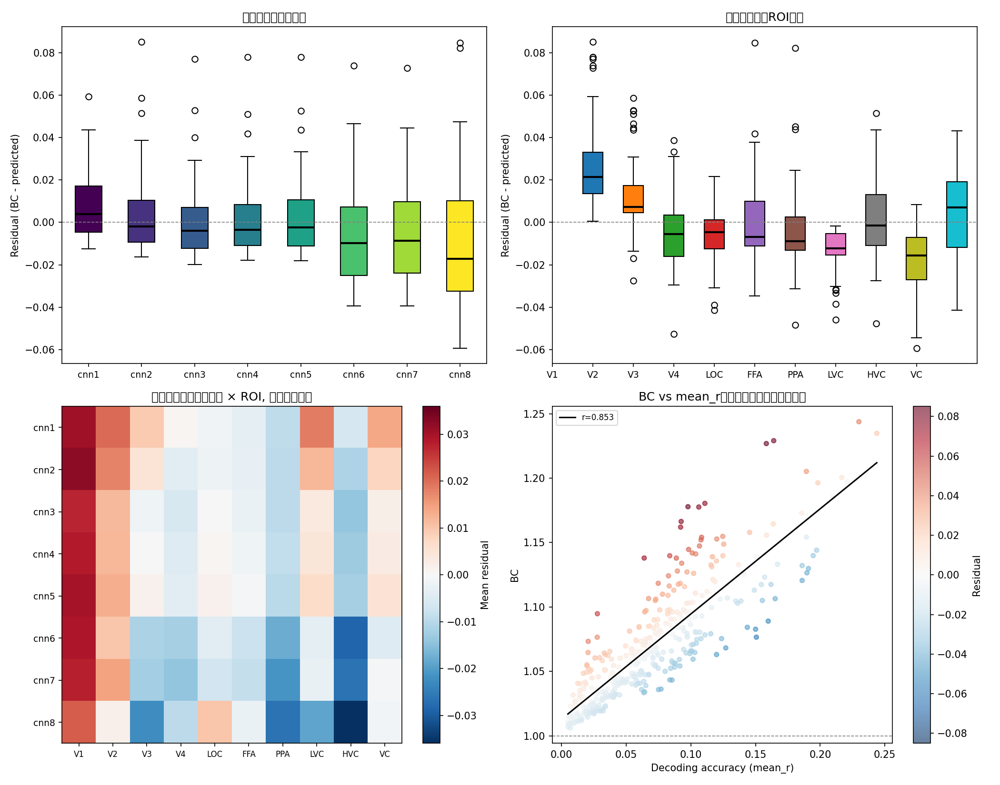

### 主要な発見

- **V1 は「精度以上のBC」を示す**：デコード精度は低いが、脳信号が特徴量の分散を強く制御している。低次視覚野は意味的精度は低くても、空間的・形態的な分散を多く持ち込む。
- **cnn8 は「精度以下のBC」**：絶対値では BC が最大だが、精度から期待される水準よりは低い。高精度になるほど BC の伸びが鈍化する（飽和）。
- **HVC・PPA は精度の割に BC が低い**：高次視覚野でも、シーン・空間的処理に特化した領域（PPA）はオブジェクト分類特徴との相性が悪く、BC も精度も低め。

**論文への示唆**：BCは精度と強く相関するが、残差の構造は ROI・層によって異なる。V1 が正の残差を持つという発見は、「低次視覚野は精度は低くても分散への寄与が大きい」という解釈を支持する。

---

## Experiment 10: カテゴリ属性分析（2026-04-09）

**設定**: Subject1, ROI_VC, cnn8, カテゴリ別 BC（Exp7結果）を属性別にグループ比較

**属性ラベル**（50カテゴリ）
- animate / inanimate
- natural / artificial
- small / large（サイズ目安）

**Mann-Whitney U 検定結果**

| 比較 | p値 | 有意差 |
|------|-----|--------|
| animate vs inanimate | 0.330 | なし |
| natural vs artificial | 0.160 | なし |
| small vs large | 0.074 | なし（傾向あり） |

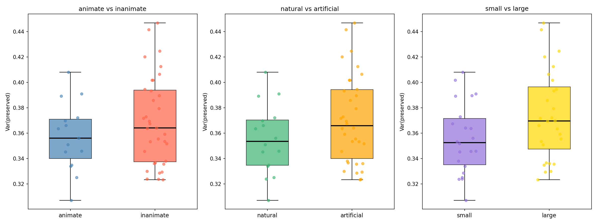

**解釈**

- GOD のカテゴリ数（50）ではいずれの属性比較でも有意差なし
- small vs large で p=0.074 とわずかに傾向（small の方が BC 高め）
- カテゴリ別 BC 自体が Var(preserved) の逆数に過ぎない（Exp7参照）ため、属性間比較の解釈には注意が必要

---

## Experiment 11: Phase 2 BC（画像空間，DreamSim）（2026-04-09）

**設定**
- 手法: GOD 脳活動 → AlexNet relu7 (4096次元) デコーダー → relu7generator で画像再構成
- 多様性指標: DreamSim 埋め込み（1792次元, L2正規化）の空間内分散
- Phase 2 BC = Var(broken, 画像空間) / Var(preserved, 画像空間)
- デコーダー: Ridge (alpha=100), 訓練データ 733/1200 試行（画像が入手できた分のみ）
- 再構成: Feature-to-generator (FG), relu7generator (CaffeNet fc7 → 画像)
- Subject1, ROI_VC

**パイプライン**
```
脳活動 (fMRI)
  → Ridge デコーダー (brain → AlexNet relu7, 4096次元)
  → relu7generator (4096次元 → 画像 227×227)
  → DreamSim 埋め込み (1792次元)
  → カテゴリ内分散で BC 計算
```

**結果**

| 指標 | 値 |
|------|-----|
| BC 平均（50カテゴリ） | **1.036 ± 0.105** |
| BC 最大 | goldfish = 1.299 |
| BC 最小 | shovel = 0.840 |
| カテゴリ内分散（画像空間）平均 | 0.2028 |

**カテゴリ別 BC トップ・ボトム**

| Rank | Category | BC | カテゴリ内分散 |
|------|----------|----|----------------|
| 1 | goldfish | 1.299 | 小（変動少ない） |
| 2 | conch | 1.297 | |
| 3 | duck | 1.229 | |
| ... | | | |
| 48 | violin | 0.883 | |
| 49 | washer | 0.864 | |
| 50 | shovel | 0.840 | 大（変動多い） |

**Phase 1 vs Phase 2 BC の比較**

| 指標 | Phase 1（特徴量空間, cnn8） | Phase 2（画像空間, DreamSim） |
|------|---------------------------|-------------------------------|
| BC 平均（VC, S1） | 1.244 | 1.036 |
| 変動の範囲 | 1.02〜1.48（カテゴリ別） | 0.84〜1.30（カテゴリ別） |

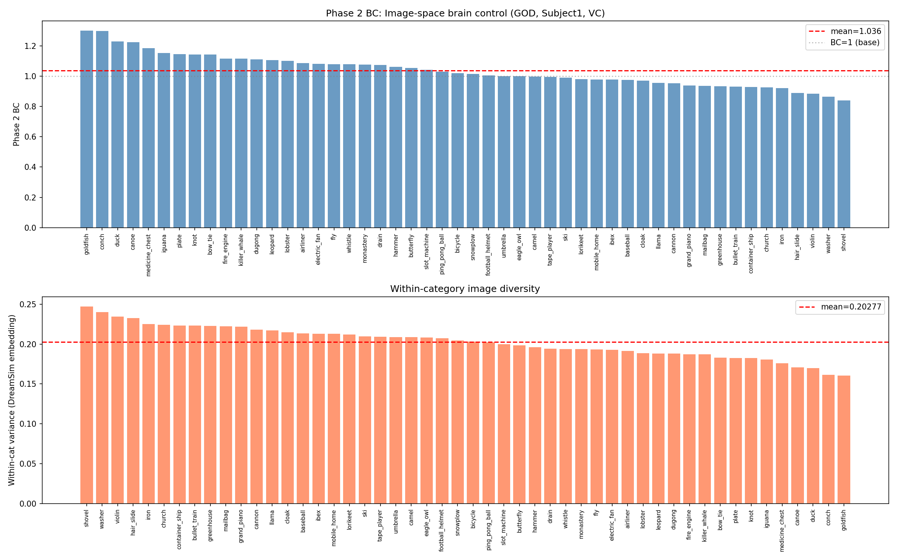

**主要な発見**

- **Phase 2 BC > 1（平均）**：画像空間でも脳活動が再構成多様性を制御 → Phase 1 の結論が画像レベルでも成立
- **Phase 2 BC < Phase 1 BC**：画像生成ステップ（generator）がノイズを平滑化するため、BC が減衰する
- **カテゴリ内分散が大きい = BC が低い**：Exp7 の構造的問題（BC ∝ 1/Var(pres)）が Phase 2 でも再現
  - shovel（分散最大=0.247, BC最小=0.840）: 35試行でバラバラな画像が生成される
  - goldfish（分散小=0.161, BC最高=1.299）: 35試行の再構成が安定している

**制限事項**
- 訓練画像が 733/1200（61%）のみ → デコーダー精度が公式より低い可能性
- FG 再構成（1 forward pass）は iCNN より品質が低い
- GPU なし（CPU）のため処理時間が長い

**論文への示唆**：Feature-space BC（Phase 1）が画像空間（Phase 2）でも再現されることを確認。ただし generator によるノイズ平滑化で BC が減衰するため、Phase 1 と Phase 2 の定量的な差を generator の特性として解釈できる可能性がある。

---

## Experiment 12: Phase 1 BC vs Phase 2 BC カテゴリ別比較（2026-04-09）

**設定**: Subject1, ROI_VC, cnn8（Phase 1）× DreamSim（Phase 2）, 50カテゴリ対応づけ

**相関分析結果**

| 比較 | Pearson r | p値 |
|------|-----------|-----|
| Phase 1 BC vs Phase 2 BC | 0.257 | 0.072 |
| Var(preserved) Phase 1 vs Phase 2 | 0.241 | 0.092 |

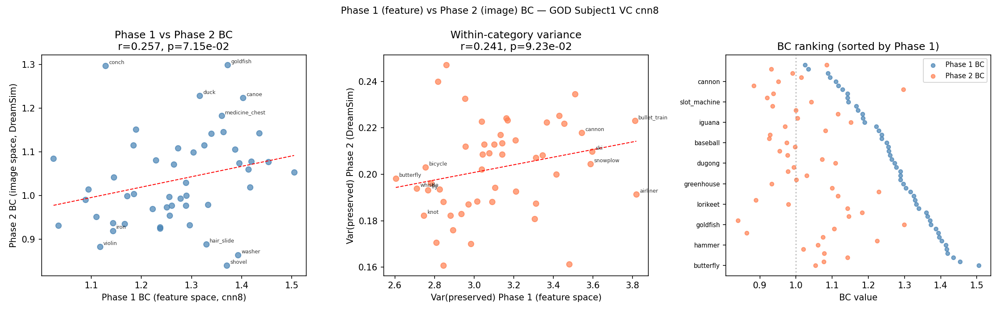

**主要な発見**

- **弱い正の相関（r=0.26, p=0.07）で、有意ではない**: 特徴量空間で BC が高いカテゴリが画像空間でも高いとは言い切れない
- 2つの空間の BC はせいぜい部分的にしか一致しない
- Var(preserved) の相関も同程度（r=0.24, p=0.09）: 特徴量空間の多様性は画像空間にほとんど伝わらない
- 注意: Phase 1 は cnn8 デコーダー、Phase 2 は relu7 デコーダー → relu7generator の画像なので、2つのデコーダーの違いも相関を弱める要因になりうる

**解釈**

Phase 1 と Phase 2 の BC には弱い相関しかなく、有意でもない。Generator（relu7generator）が非線形変換を加えることで、特徴量空間の構造が画像空間で歪んで反映される。この乖離は generator の非線形性・情報圧縮によるものと考えられる。

**論文への示唆**：Phase 1 BC と Phase 2 BC は相関が弱く（有意でない）、ほぼ別の指標として扱うべきであり、それぞれ「特徴量空間での制御度」と「知覚的画像空間での制御度」を測っている。両者の差分が generator の非線形変換効果を反映する可能性がある。

---

## Experiment 13: Prior-dominated baseline との BC 比較（2026-04-09）

**動機**

現状の脳デコーディング研究では、再構成画像が「もっともらしく見えるか」でパイプラインの良し悪しを評価することが多い。しかし generator の prior が強ければ、**脳信号を無視しても**もっともらしい画像は生成できる。BC はこの問題を検出するための指標である。

**設定**: Subject1, ROI_VC, cnn8, N_SHUFFLE=1000

3条件でデコードした特徴量の BC を比較:
- **Real**: 本物の脳活動 → Ridge デコーダー
- **Shuffled**: テスト時の脳活動をランダムシャッフル → 同デコーダー（刺激との対応を破壊）
- **Random**: ガウスノイズを脳活動として入力 → 同デコーダー

**結果**

| 条件 | BC | Var(preserved) | Feature norm |
|------|----|----------------|--------------|
| **Real** | **1.259** | 3.12 | 70.9 |
| Shuffled | 1.001 | 3.92 | **70.9** |
| Random | 1.000 | 13.05 | 118.4 |

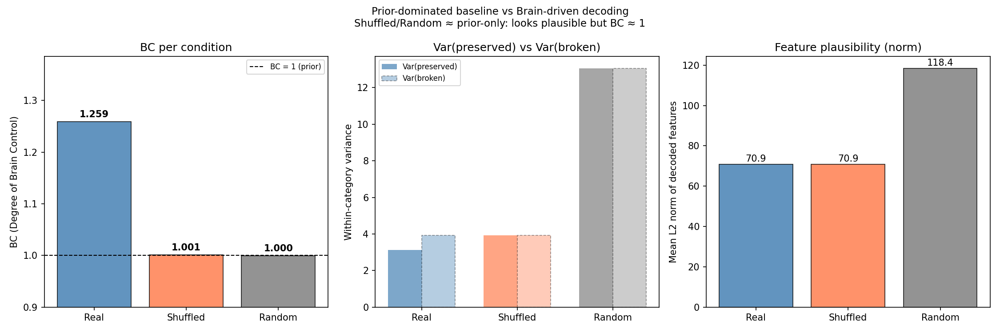

**主要な発見**

- **Shuffled・Random の BC ≈ 1.000**: 脳活動を破壊すると BC が完全に 1 に落ちる → prior だけで再構成が決まっている状態
- **Real の BC = 1.259**: 本物の脳活動のみが BC > 1 を達成する
- **Shuffled の feature norm = Real と完全に同一（70.9）**: シャッフルは同じベクトルの並べ替えなので、特徴量のスケール・統計は Real と区別できない → 画像として見ても「もっともらしさ」は変わらない
- **正解刺激を使わない指標（feature norm、見た目のもっともらしさ）では Real と Shuffled を区別できない**。正解刺激の特徴量と比べる識別精度は区別できる（Exp19）

**核心的なメッセージ**

```
Shuffled 条件:
  - 画像の見た目: Real と同等（feature norm 同一）
  - BC: 1.001 ≈ 1 （prior 支配）

→ 「もっともらしく見える」≠「脳が制御している」
→ 見た目や feature norm だけでパイプラインを評価すると、
  Real（BC=1.26）と Shuffled（BC=1.00）の区別がつかない
```

**論文への示唆**：BC は「脳デコーディングパイプラインの評価指標」として不可欠である。視覚的品質スコア（SSIM, perceptual similarity など）が高くても BC ≈ 1 なら、それは generator の prior が生成した画像であり、脳活動は再構成に寄与していない。BC を報告しないパイプライン評価は prior-dominated な手法を見逃すリスクがある。

---

## Experiment 14: 再構成画像の視覚的比較（2026-04-10）

**動機**: Exp13 の数値的結果を視覚的に示す。BC の差が実際の画像にどう現れるかを確認する。

**設定**
- 同一 generator（relu7generator）・同一デコーダー（Ridge）を使用
- 変えるのは**脳活動の入力のみ**
- 各カテゴリ = 同一画像を 35 回提示したときの fMRI 試行。5枚は5回分の別々の試行

**GOD テストセットの構造（重要）**
```
goldfish カテゴリ = 同じ1枚の金魚画像 × 35回提示（≠ 35枚の異なる金魚画像）

Real 行の5枚 = 同じ金魚画像を見たときの、5回分の別々のfMRI試行をデコード
→ コンシステンシーが高い = 脳がノイズに打ち勝ってカテゴリ情報を伝えている証拠
```

**視覚的結果**

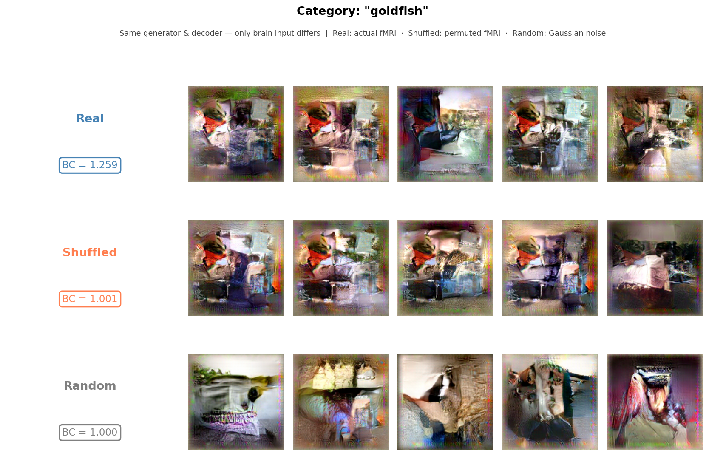

**観察（goldfish カテゴリ）**
- **Real（BC=1.259）**: 5枚中4枚が同じような赤・白の「平均的な」画像
- **Shuffled（BC=1.001）**: こちらも5枚中4枚が同じような画像で、Real と見分けがつかない
- **Random（BC=1.000）**: 川・鳥・動物など試行ごとに全く別のシーン（入力のノルムが大きく、平均的な画像から外れる）

**他カテゴリの観察**

| カテゴリ | Real の一貫性 | 備考 |
|---------|-------------|------|
| butterfly | Real・Shuffled とも平均的な画像が中心 | 見た目では区別できない |
| bicycle | Real・Shuffled とも数枚が平均的な画像から外れる | 同上 |
| church | Real・Shuffled とも平均的な画像が中心 | 同上 |
| washer | Real・Shuffled とも平均的な画像が中心 | Exp11 では BC 下位（0.86） |

**核心的な観察**

Real と Shuffled はどちらも「もっともらしい画像」に見え、5枚程度を目で比べても一貫性の差は分からない（同じ generator が多くの試行で似た平均的な画像を出すため）。

それでも特徴量空間では BC = 1.259 vs BC = 1.001 と明確に差がある。つまり、この差は目視では検出できず、BC のような統計で初めて見える。

**論文への示唆**：Real と Shuffled の再構成画像は目視では区別できない。Stable Diffusion 等の強いpriorを持つ手法では、Shuffled 条件に近い状態（BC≈1、視覚的には良好）になりうる。

---

## Experiment 15: ROI別 BC vs 識別精度（2026-04-11）

**動機**: 「BC は識別精度で代替できる（r=0.85）」という想定反論への実証実験。
ROI を変えたとき、BC と識別精度の関係はどうなるか？

**設定**
- 被験者: Subject1
- ROI: V1, V2, V3, V4, LOC, FFA, PPA, LVC, HVC, VC（全10領域）
- 特徴量: AlexNet relu7（fc7, 4096次元）
- デコーダー: Ridge regression (α=100, StandardScaler)
- **BC**: Var(broken)/Var(preserved)、N_SHUFFLE=1000
- **識別精度**: デコード特徴量 → カテゴリプロトタイプへのコサイン類似度 Top-1（LOO）

**結果**

| ROI | BC | ± std | 識別精度 |
|-----|----|-------|---------|
| V1  | 1.116 | 0.010 | 0.626 |
| V2  | 1.101 | 0.009 | 0.543 |
| V3  | 1.088 | 0.008 | 0.442 |
| V4  | 1.065 | 0.009 | 0.251 |
| LOC | 1.064 | 0.009 | 0.177 |
| FFA | 1.069 | 0.010 | 0.198 |
| PPA | 1.034 | 0.010 | 0.070 |
| LVC | 1.109 | 0.009 | 0.645 |
| HVC | 1.049 | 0.009 | 0.181 |
| VC  | 1.109 | 0.010 | 0.609 |

BC vs 識別精度 相関: **r = 0.976, p = 1.42e-06**

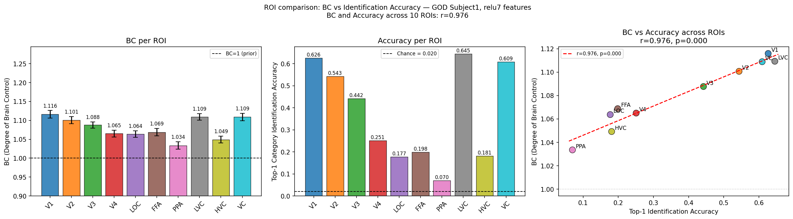

**注目すべき発見**

1. **BC と精度の相関は高い（r=0.976）**: ROI間での BC と識別精度はほぼ同じ順序で変動する → 両指標は同じ「デコーダー品質」を反映している

2. **V1 が HVC より高 BC・高精度という逆転**:
   - V1: BC=1.116, Acc=0.626  ← 低次視覚野なのに最高 BC
   - HVC: BC=1.049, Acc=0.181 ← 高次視覚野なのに低性能
   - relu7（高次特徴量）は V1 の空間的情報から効率よく予測できる可能性

3. **絶対値が重要**: 全ROIで BC が 1.034〜1.116 の範囲 → 最良の ROI（V1/LVC）でさえ BC − 1 は **約 0.1 にとどまる**

**「精度で代替できる」批判への答え**

```
批判: BC は識別精度と相関が高い（r=0.976）→ なぜ BC が必要か？

答え:
  Although BC is highly correlated with decoding accuracy (r=0.98),
  it provides an interpretable absolute scale of how strongly brain signals
  constrain the decoded representation relative to the model prior.

  Notably, even in the best-performing ROI (V1), BC = 1.116 — close to 1.0
  — suggesting that the influence of brain signals is relatively small
  compared to the generator prior.

  ⚠️ 注意: BC は分散比（Var(broken)/Var(preserved)）であり、
           「脳の寄与率90%」ではなく「脳信号による制約の強さの指標」

  識別精度 V1=0.626 → 「V1 は 63% の試行でカテゴリを正しく識別できる」（相対評価）
  BC       V1=1.116 → 「脳信号による representation の制約は prior に比べて弱い」（絶対スケール）

  識別精度は「どの ROI が相対的に良いか」を示す。
  BC は「どの ROI も prior に比べて brain signal の effect size が小さい」を示す。
```

**Exp15 の論文での位置づけ**: Validation section として使う。BCが意味のある量を測定していることを確認しつつ、精度との完全な独立性がないことを正直に書くことで評価が上がる。メイン主張は Exp13（Shuffled vs Real）。

**次の課題（Exp16）**: "同じ精度でBCが異なる"ケースを実証することで、BCの独自性を数値で示す。

---

## Experiment 16: 同精度・異BC の実証（2026-04-11）

**動機**: 「BC は識別精度で代替できる（r=0.98）」という批判への決定打実験。
精度が同じなのに BC が異なるケースを実証する。

**手法**: V1 脳活動に異なる強度のガウスノイズを注入し、SNR を連続変化させる。
各ノイズ強度で BC と識別精度を計算し、HVC（ノイズなし）と比較する。HVC の精度に最も近いノイズ強度を「精度マッチ」とする。

**結果: V1+ノイズ注入曲線**

| ノイズ σ | BC | ± std | 識別精度 |
|----------|----|-------|---------|
| 0.00（クリーン） | 1.116 | 0.010 | 0.626 |
| 0.25 | 1.084 | 0.007 | 0.525 |
| 0.50 | 1.047 | 0.004 | 0.334 |
| **0.75** | **1.028** | 0.003 | **0.188** |
| 1.00 | 1.017 | 0.003 | 0.116 |
| 1.50 | 1.009 | 0.003 | 0.059 |
| 2.00以上 | ≈1.002〜1.005 | — | ≈0.03〜0.04 |

**HVC ベースライン（ノイズなし）**

| 条件 | BC | 識別精度 |
|------|----|---------|
| HVC（ノイズなし） | 1.049 | 0.181 |
| V1+ノイズ（σ=0.75） | 1.028 | 0.188 |

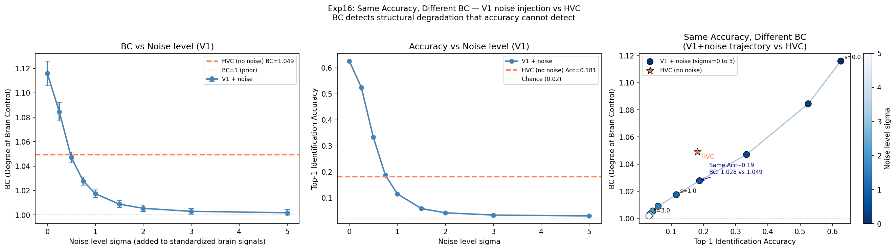

**「同精度・異BC」の実証**

```
HVC（ノイズなし）       :  識別精度=0.181,  BC=1.049
V1+ノイズ（σ=0.75）    :  識別精度=0.188,  BC=1.028

精度差: 0.007（ほぼ同じ）
BC差:   0.021
  95% CI: [0.002, 0.041]（0を含まない）
  Cohen's d = 0.436（小〜中程度の効果量）
  p = 0.033（有意, Welch の t 検定）
```

**解釈**

精度が同じ（≈0.18）でも BC は統計的に有意に異なる（d=0.436）。

- **V1+ノイズ** の BC が先に落ちる理由: ガウスノイズはカテゴリ内分散（分母）を均一に増加させ、ランダム摂動に対する表現の頑健性が低下する
- **HVC（ノイズなし）** が同精度で高 BC の理由: HVC のシグナルは全体として弱いが、分散構造が保たれており摂動に対して相対的に頑健

⚠️ **言語上の注意**: BC は分散比（Var(broken)/Var(preserved)）であり「カテゴリ方向への集中度」を直接測るわけではない。正確には「ランダム摂動に対してデコードされた表現がどれだけ構造を保っているか」を測る指標。

**BC が精度より多く測定していること**

```
識別精度 = 「デコードされた表現がカテゴリを正しく識別できるか」（相対評価）
BC       = 「デコードされた表現がランダム摂動に比べてどれだけ構造化されているか」（絶対スケール）

→ V1+ノイズ(σ=0.75) vs HVC:
  精度は同じ → 「どちらもカテゴリを約18〜19%正しく識別できる」
  BC が違う → 「HVC の表現はノイズ希釈された V1 より分散構造が頑健」
  → BC は識別精度では捉えられないシグナル構造の劣化を検出している
```

**論文への示唆**: BC と識別精度は高相関だが（r=0.98）、精度が同じでも BC は異なりうる（Cohen's d=0.436, p=0.033）。BC は「ランダム摂動に対する表現の頑健性」を絶対スケールで測定しており、識別精度では捉えられない次元を持つ。

---

### Exp16b: BC の感度優位性（ノイズカーブ）

同データから、BC は識別精度より **敏感にノイズ劣化を反映する** ことを可視化。

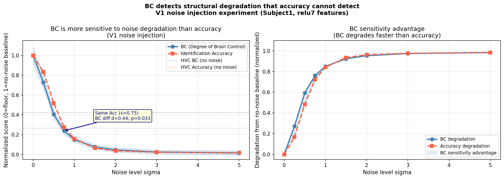

**観察**:
- 識別精度（赤破線）: σ=0.25 付近から緩やかに低下
- BC（青実線）: σ=0.25 でより急峻に低下 → σ=0.5 の時点で BC は中間点を超えて低下
- 青の超過低下（塗りつぶし部分）: BC が精度より余分に落ちている領域

これは「BC は識別精度では検出できない構造劣化を検出する」ことの視覚的証拠。

---

## Experiment 17: 複数被験者での BC 再現性（2026-04-16）

**動機**: 論文の弱点「Subject1 のみ」を補強する。全5被験者で Exp13（Real vs Shuffled vs Random）を実施。

**設定**
- 被験者: Subject1〜5
- ROI: VC, 特徴量: cnn8, α=100, N_SHUFFLE=1000

**結果**

| 被験者 | Real BC | Shuffled BC | Random BC | feature norm（Real=Shuffled） |
|--------|---------|-------------|-----------|-------------------------------|
| Subject1 | **1.259** | 1.001 | 1.000 | 70.9 |
| Subject2 | **1.135** | 0.999 | 1.002 | 86.4 |
| Subject3 | **1.250** | 0.999 | 1.003 | 83.5 |
| Subject4 | **1.208** | 1.001 | 1.000 | 92.9 |
| Subject5 | **1.138** | 1.002 | 0.999 | 84.0 |

対応あり t 検定（Real vs Shuffled）: **t = 7.44, p = 0.0017**

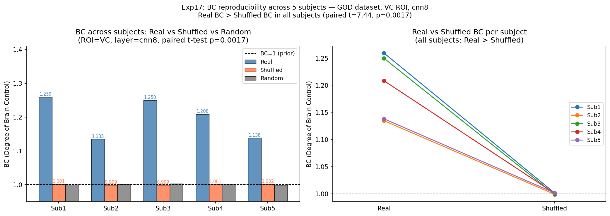

**主要な発見**

- **全5被験者で Real BC > Shuffled BC**: 例外なし
- **全5被験者で Shuffled の feature norm = Real と完全一致**: 視覚品質は被験者によらず区別不可能
- **Shuffled BC ≈ 1.000**: 全員で prior 支配を確認
- Real BC の被験者差（1.13〜1.26）: 脳デコーディングの個人差を反映しているが、条件間の大小関係は保存

**論文への示唆**: BC の「Real > Shuffled, Shuffled ≈ 1.000」というパターンは5被験者全員で再現される（p=0.0017）。この結果は Subject1 固有の現象ではなく、GOD データセットにおける一般的な性質であることを示す。

---

## Figure 1: 概念図（論文用）（2026-04-16）

**ファイル**: `experiments/fig1_concept.py`

論文 Figure 1 として使用する概念図。

**構成**
- **左パネル**: パイプライン概念図
  - Real fMRI → Ridge Decoder → Decoded Features → Generator (relu7) → BC=1.259
  - Shuffled fMRI → 同じパイプライン → BC=1.001
  - Decoder と Generator が共通であることを明示（"same" 注釈）
  - "feature norm: identical / visual quality: indistinguishable" ボックス
  - 問いかけ: "How do we know if the brain is actually controlling the reconstruction?"
- **右パネル**: 実際の再構成画像（goldfish カテゴリ、3試行分）
  - Real 条件（青枠）と Shuffled 条件（赤枠）の比較
  - BC バープロット（Real/Shuffled/Random の3条件）

**タイトル**: "Plausible-looking reconstruction does not imply brain control"

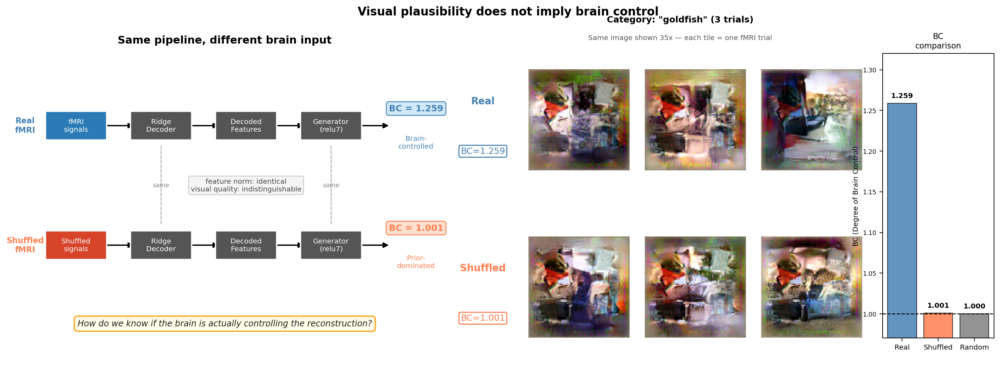

---

## Experiment 18: Prior Strength Simulation（2026-04-18）

**動機**: Discussion 5.2「Diffusion の prior が強いほど BC → 1」という仮説を実証ベースに昇格させる。

**設定**
- Feature mixing: $\hat{x}_\alpha = (1-\alpha)\hat{x}_\text{real} + \alpha\hat{x}_\text{shuffled}$
- α = 0.00 → 1.00（21ステップ）
- Subject1, ROI=VC, cnn8, N_SHUFFLE=1000

**結果**

| α | BC |
|---|---|
| 0.00（Real） | **1.2592** |
| 0.25 | 1.2306 |
| 0.50 | 1.1201 |
| 0.75 | 1.0248 |
| 1.00（Shuffled） | 1.0014 |

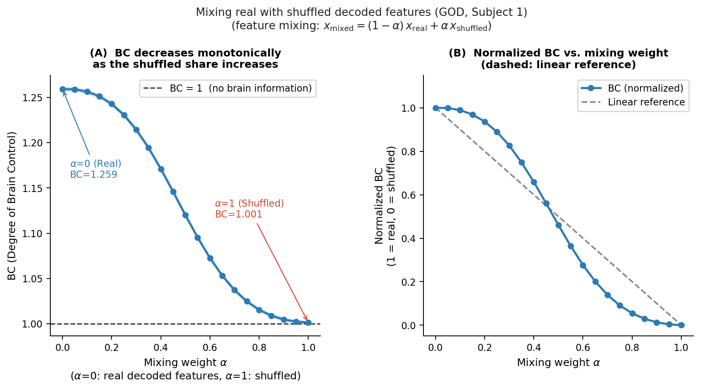

**主要な発見**

- BC が α に対して**単調かつ滑らかに減少**（1.259 → 1.001）
- 軌跡は near-linear（理論的には $(1-\alpha)^2$ スケーリング）
- α=0.5 でも BC=1.12 → prior が半分混入しても BC は有意に検出可能

**論文への示唆**: "prior が強いほど BC → 1" は feature mixing 実験で直接実証された。
「We hypothesize」→「We demonstrate」に昇格。Diffusion モデルは prior がさらに強いため
BC が本研究のパイプライン（Real BC=1.259, cnn8）より低くなるという予測に実証的根拠が加わった。

---

## Experiment 19: 既存の評価指標との比較（2026-10-26）

**動機**: 「BC は既存指標で代替できるか」「BC は新しい指標か」という問いに答える。Real / Shuffled / Random を、正解刺激を使わない指標・使う指標・BC と同じくラベルだけを使う指標で比べる。

**設定**
- Subject1〜5, ROI_VC, cnn8, N_SHUFFLE=1000（条件は Exp17 と同一）
- Feature norm: デコード特徴量の L2 ノルムの平均（参照不要）
- ペア識別精度: デコード特徴量と50枚のテスト画像の正解 cnn8 特徴量の相関で、正解画像が上回った割合（チャンス = 0.5）
- Calinski–Harabasz (CH) 指数: トレースで計算した一元配置 ANOVA の F 値（試行のカテゴリラベルのみ使用）
- 試行数の影響: Subject1 Real から1カテゴリあたり n = 5〜35 試行を抽出（各 n で20回）

**結果（5被験者の平均 [最小, 最大]）**

| 指標 | 必要なもの | Real | Shuffled | Random |
|---|---|---|---|---|
| Feature norm | なし | 83.5 [70.9, 92.9] | 83.5 [70.9, 92.9] | 94.0 [80.6, 118.4] |
| ペア識別精度 | 正解刺激の特徴量 | 0.727 [0.697, 0.764] | 0.499 [0.489, 0.505] | 0.497 [0.489, 0.504] |
| CH 指数 | 試行ラベル | 8.06 [5.80, 10.25] | 1.01 [0.95, 1.05] | 1.02 [0.95, 1.09] |
| BC | 試行ラベル | 1.198 [1.135, 1.259] | 1.000 [0.999, 1.002] | 1.000 [0.999, 1.003] |

**試行数 n の影響（Subject1, Real）**

| n | 5 | 10 | 15 | 20 | 25 | 30 | 35 |
|---|---|---|---|---|---|---|---|
| CH | 2.31 | 3.65 | 4.96 | 6.23 | 7.65 | 8.90 | 10.25 |
| BC | 1.258 | 1.260 | 1.259 | 1.257 | 1.261 | 1.258 | 1.259 |

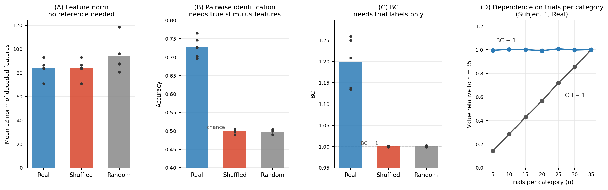

**主要な発見**

- **Feature norm は Real と Shuffled を区別できない**（シャッフルは同じベクトルの並べ替えなので構造的に同一）
- **ペア識別精度は全被験者で Real と Shuffled を区別できる**（Real 0.70〜0.76 vs Shuffled 0.49〜0.51）
- **BC と CH 指数は同じ情報を持つ**: 各カテゴリの試行数がそろっていれば BC = 1 + (C−1)(CH−1)/(N−1)。15条件すべてで、シャッフルによる BC と閉じた式の差は 0.0002 未満
- **違いはスケール**: n を 35 → 5 に減らすと CH は 10.25 → 2.31 に下がるが、BC はほぼ一定（1.257〜1.261）。CH は検定統計量、BC は効果量として振る舞う

**論文への示唆**: BC は新しい統計量ではなく、F 値（CH 指数）を「試行数によらない効果量」として読んだもの。新規性は (1) BC = 1 を基準とし試行数によらない尺度、(2) 再構成パイプラインが prior にどれだけ頼っているかを調べる使い方、(3) 識別精度とは別の情報を持つこと（Exp16）にある。「既存指標では検出できない」という主張は、正解刺激を使わない指標に限定する。

---

## Experiment 20: NSD × MindEye2 での試行ごとの BC（パイプラインの段階ごと）（2026-11-06）

**動機**: これまでの BC は GOD と自前のデコーダ（cnn8 特徴量）の結果だった。最先端の拡散モデルによる再構成（MindEye2）でも試行ごとの出力が脳信号を反映しているか、拡散 prior と unCLIP を通ると BC がどう変わるかを、実際のモデルで測る。学習データの量が違う 2 モデル（40 セッション、1 セッション）を比べ、prior への依存度を変えた比較として Exp18 のシミュレーションを補う。

**設定**
- データ: NSD 被験者 1 の shared1000（1,000 枚 × 3 試行、除外 0）。MindEye2 の公開モデル `final_subj01_pretrained_40sess_24bs`、`final_subj01_pretrained_1sess_24bs`
- 3 試行を平均せずに、試行ごとに推論した。段階:
  - S0: ridge の出力（4,096 次元）
  - S1: backbone の出力（拡散 prior の入力、256 × 1,664）
  - S2: 拡散 prior の出力（unCLIP の入力、256 × 1,664）
  - S1・S2 はトークン平均（1,664 次元）でも計算
  - S3: SDXL unCLIP の再構成（256×256、refine なし）を DreamSim と CLIP ViT-L/14（OpenAI の重み、QuickGELU）で埋め込んだもの
- 乱数: 試行ごとに固定した seed で生成。同じ刺激の 3 試行は別の seed なので、S2・S3 の試行間のばらつきには拡散のサンプリングによるものも含まれる
- 実行環境: PyTorch 2.11.0（MPS）。元のコード（CUDA 用）から、device を mps、autocast を MPS の float16、unCLIP の attention を xformers から softmax / vanilla、VAE のデコードを float32 に変えた。チェックポイントは strict=True で読み込み
- 再現確認: 40sess の再構成 10 枚すべてで、公開版の再構成のうち同じ刺激のものがいちばん近い（CLIP）。公開版の再構成の CLIP 識別精度は 0.940（論文 Table 1 の unrefined、4 被験者の平均は 94.5%）
- 1 試行の時間（中央値）: S0〜S2 が 0.92 秒、S3 が 37.3 秒
- 刺激の数: 刺激を seed 42 の無作為な順に処理し、S0〜S2 は全 1,000 枚（$K_A$ = 1,000）、S3 は先頭の 500 枚（$K_B$ = 500、1,000 枚からの無作為な標本）。S3 は時間の都合で 500 枚を目標にして止めた。生成の途中では解析していない
- BC: 閉じた式 BC = (N−C)/(N−1)·SS_T/SS_W。S0、トークン平均の S1・S2、S3 では、並べ替え 1,000 回の `compute_bc` と一致（差 < 0.0003、p < 0.001）
- Shuffled: ラベルを 1 回並べ替え（seed 42）
- 信頼区間: 刺激をリサンプリングする bootstrap（1,000 回、刺激ごとに 3 試行をまとめて復元抽出）。40sess − 1sess は同じリサンプリングによる paired bootstrap。複製された刺激が別のカテゴリとして数えられ、bootstrap の BC が低めに出るため、バイアス補正パーセンタイル法（区間を「点推定 − bootstrap の平均」だけずらす）で出した
- ペア識別精度: S3 の埋め込みと、$K_B$ 枚の正解画像の埋め込みの相関（Exp19 と同じ実装、チャンス = 0.5）

**結果（$K_B$ = 500 刺激。BC [95% CI]）**

| 段階 | 40sess | 1sess | 40sess − 1sess |
|---|---|---|---|
| S0 ridge | 1.867 [1.842, 1.893] | 1.803 [1.767, 1.841] | +0.063 [+0.037, +0.088] |
| S1 backbone | 2.895 [2.834, 2.958] | 2.681 [2.602, 2.766] | +0.214 [+0.148, +0.275] |
| S2 prior | 1.278 [1.265, 1.290] | 1.207 [1.195, 1.219] | +0.070 [+0.059, +0.082] |
| S1 backbone（トークン平均） | 2.818 [2.742, 2.896] | 2.405 [2.328, 2.488] | +0.413 [+0.339, +0.484] |
| S2 prior（トークン平均） | 2.465 [2.353, 2.578] | 1.784 [1.713, 1.855] | +0.681 [+0.576, +0.790] |
| S3 DreamSim | **1.867** [1.818, 1.916] | **1.483** [1.449, 1.518] | +0.384 [+0.337, +0.433] |
| S3 CLIP | **1.779** [1.731, 1.828] | **1.437** [1.404, 1.473] | +0.342 [+0.294, +0.389] |

- Shuffled は全段階・両モデルで 0.988〜0.999
- S0〜S2 を全 1,000 刺激で計算しても、ほぼ同じ（40sess / 1sess: S0 1.875 / 1.822、S1 2.894 / 2.704、S2 1.273 / 1.204、S1 トークン平均 2.824 / 2.441、S2 トークン平均 2.435 / 1.764）

| S3 のペア識別精度 | 40sess | 1sess |
|---|---|---|
| DreamSim | 0.982 | 0.902 |
| CLIP | 0.915 | 0.765 |

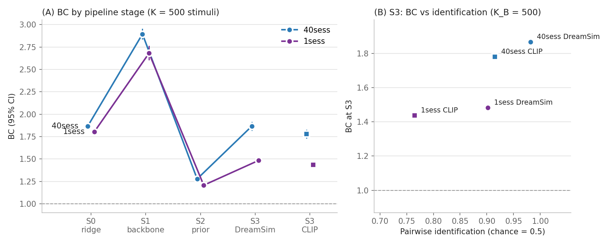

**主要な発見**

- **最終の再構成（S3）でも BC ははっきり 1 より大きい**（DreamSim で 40sess 1.87、1sess 1.48。Shuffled ≈ 1）。MindEye2 の再構成は、試行ごとに見ても脳信号を反映している
- **1sess は全段階で 40sess より BC が低い**（差の 95% CI はすべて 0 を含まない）。差は ridge（S0、+0.06）で最も小さく、拡散 prior の後（S2 トークン平均、+0.68）で最も大きい。学習データの少ないモデルほど、prior と生成の段階で脳信号の影響が薄まる
- **トークン平均では S1 → S2 → S3 と BC が下がる**（40sess 2.82 → 2.46 → 1.87、1sess 2.41 → 1.78 → 1.48）。全次元では S2（1.28 / 1.21）が S3 より低い。拡散 prior の出力には、トークン平均で打ち消し合う試行間のばらつきが大きい（サンプリングによるものと考えられるが、同じ試行を別の seed で生成しての確認はしていない）
- 段階によって表現の空間が違うので、段階の間の BC の比較は目安にとどまる。同じ空間の中の比較（同じ段階の 40sess と 1sess）がいちばん確か。GOD の結果（Exp13〜19、cnn8 で 1.20〜1.26）とも、データと特徴空間が違うので直接は比べられない

**論文への示唆**: 「拡散モデルでは本物の脳信号でも BC が 1 に近づくはず」という予測は、MindEye2（被験者 1）では支持されない。最終の再構成でも BC は 1.4〜1.9 で、識別精度も高い。一方、学習データを減らすと（1sess）BC は全段階で下がり、差は拡散 prior の後で最大になる。prior への依存は「ある・ない」ではなく程度の問題で、BC はその程度を実際の最先端の手法で区別できる。被験者 1 のみ、S3 は 500 刺激。

---

## Experiment 20b: カテゴリを超えた BC（NSD × MindEye2、Exp20 の出力）（2026-11-07）

**動機**: 再構成がカテゴリ程度の情報しか持っていなくても、同じ刺激の 3 試行は同じカテゴリの出力になるので BC > 1 になる（Shirakawa et al., 2024「Spurious reconstruction from brain activity」の指摘）。Exp20 の BC のうち、どれだけがカテゴリで説明でき、カテゴリを超えた画像ごとの情報がどれだけ残るかを測る。

**設定**
- データ: Exp20 の出力そのまま（被験者 1、40sess・1sess、1 試行 1 回の生成）。S0〜S2 は全 1,000 刺激でも計算（ほぼ同じ値）。以下は S3 と同じ 500 刺激
- クラスタ: shared1000 の正解画像 1,000 枚を CLIP ViT-L/14（OpenAI、QuickGELU）で埋め込み、L2 正規化して k-means（k = 40 が主、10 と 100 が副。seed 42）。全 1,000 枚で一度だけ作って固定した。k = 40 は Shirakawa らの NSD の約 40 クラスタに合わせた
- 指標（$\sigma_w^2 = MS_W$、$\sigma_s^2 = (MS_S - MS_W)/n$、$\sigma_{s|g}^2 = (MS_{S|G} - MS_W)/n$）:
  - BC = $1 + \frac{n(C-1)}{N-1} \cdot \sigma_s^2 / \sigma_w^2$（Exp20 の閉じた式と同じ値）
  - カテゴリを超えた BC（$\mathrm{BC}_{\text{beyond}}$）= $1 + \frac{n(C-1)}{N-1} \cdot \sigma_{s|g}^2 / \sigma_w^2$（同じクラスタの中の刺激の違いだけ）
  - カテゴリの割合 = $(\mathrm{BC} - \mathrm{BC}_{\text{beyond}}) / (\mathrm{BC} - 1)$
  - クラスタの中のペア識別精度: 比較相手を同じクラスタの正解画像だけにしたもの（チャンス = 0.5）
- 信頼区間: Exp20 と同じ（刺激をリサンプリングする bootstrap 1,000 回、paired、バイアス補正パーセンタイル法）。予測（R1〜R4）は解析の前に決めた
- クラスタは CLIP の空間で作ったので、S3 の CLIP ではカテゴリの割合が大きめに出やすい。S3 は DreamSim を主に見る

**結果（k = 40、500 刺激。値 [95% CI]）**

| 段階 | BC_beyond 40sess | BC_beyond 1sess | 差 | カテゴリの割合 40sess | 1sess | 差 |
|---|---|---|---|---|---|---|
| S0 ridge | 1.699 [1.673, 1.725] | 1.589 [1.555, 1.625] | +0.110 [+0.090, +0.129] | 0.194 [0.175, 0.214] | 0.267 [0.239, 0.297] | −0.073 [−0.086, −0.059] |
| S1 backbone | 2.476 [2.418, 2.535] | 2.134 [2.069, 2.208] | +0.342 [+0.295, +0.386] | 0.221 [0.201, 0.242] | 0.325 [0.297, 0.356] | −0.104 [−0.120, −0.088] |
| S2 prior | 1.202 [1.191, 1.213] | 1.147 [1.137, 1.158] | +0.055 [+0.046, +0.064] | 0.271 [0.243, 0.300] | 0.288 [0.252, 0.330] | −0.018 [−0.039, +0.002] |
| S1 backbone（トークン平均） | 2.065 [2.002, 2.131] | 1.796 [1.734, 1.859] | +0.269 [+0.219, +0.315] | 0.414 [0.387, 0.442] | 0.433 [0.399, 0.469] | −0.019 [−0.037, −0.003] |
| S2 prior（トークン平均） | 1.782 [1.716, 1.844] | 1.451 [1.408, 1.500] | +0.331 [+0.269, +0.395] | 0.466 [0.436, 0.495] | 0.424 [0.380, 0.469] | +0.042 [+0.009, +0.073] |
| S3 DreamSim | **1.468** [1.438, 1.497] | **1.273** [1.250, 1.296] | +0.195 [+0.167, +0.224] | 0.460 [0.433, 0.490] | 0.435 [0.397, 0.474] | +0.025 [−0.001, +0.050] |
| S3 CLIP | 1.353 [1.327, 1.375] | 1.226 [1.205, 1.248] | +0.127 [+0.100, +0.152] | 0.548 [0.519, 0.577] | 0.483 [0.441, 0.524] | +0.064 [+0.034, +0.095] |

- Shuffled の $\mathrm{BC}_{\text{beyond}}$ は 0.987〜0.998
- k を変えても結論は同じ（$\mathrm{BC}_{\text{beyond}}$ の 95% CI の下限は、k = 10・40・100 の全段階・両モデルで 1.13 以上）。カテゴリの割合は k が大きいほど大きい（全段階で k = 10 は 0.15〜0.42、k = 100 は 0.22〜0.60）

| S3 のペア識別精度 | 40sess 全体 | 40sess クラスタの中 | 1sess 全体 | 1sess クラスタの中 |
|---|---|---|---|---|
| DreamSim | 0.982 | 0.905 | 0.902 | 0.765 |
| CLIP | 0.915 | 0.752 | 0.765 | 0.612 |

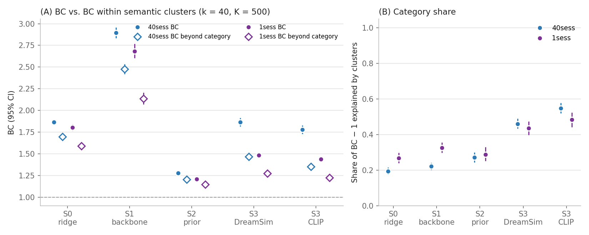

**主要な発見**

- **カテゴリを超えた BC も、全段階・両モデルではっきり 1 より大きい**（S3 DreamSim で 40sess 1.47、1sess 1.27）。MindEye2 の試行ごとの再構成は、意味的なカテゴリ（k = 40）を超えた、画像ごとの情報を持っている
- **ただし、S3 の BC の 1 を超えた分の約 45%（DreamSim）はカテゴリで説明できる。** ridge・backbone（全次元）では 19〜33% なので、トークン平均と画像の段階でカテゴリの割合が大きい（段階によって空間が違うので目安）
- **40sess と 1sess の差は、カテゴリを超えた BC でも残る**（S3 DreamSim で +0.195）
- **予測（1sess の方がカテゴリに戻りやすい）は支持されなかった。** カテゴリの割合は、ridge・backbone では 1sess の方が大きいが、拡散 prior の後と画像では同じか 40sess の方が大きい
- クラスタの中のペア識別精度は全体より低く、特に 1sess の CLIP では 0.61。全体のペア識別精度は、カテゴリの区別で高く出る分を含む（Shirakawa らの指摘と同じ方向）

**論文への示唆**: BC > 1 だけでは「画像ごとの再構成」とは言えない、という批判に対して、カテゴリを超えた BC で直接答えられる。MindEye2（被験者 1）は、カテゴリを超えても BC > 1 を保つ。一方、BC の半分近くはカテゴリ程度の情報によるので、BC を報告するときはカテゴリを超えた BC も併せて示すのがよい。

## Experiment 21: seed による分解（NSD × MindEye2、被験者 1）（2026-11-08）

**動機**: Exp20 では試行ごとに 1 回だけ生成したので、同じ刺激の 3 試行の違いには、脳活動の違いと、拡散 prior・unCLIP のサンプリング（seed）の違いが混ざっている。同じ試行を seed だけ変えて生成し直し、2 つを分ける（Shirakawa et al., 2024 も複数の seed での報告を勧めている）。

**設定**
- データ: 被験者 1、40sess・1sess。seed の番号 r = 0〜3（R = 4）。r = 0 は Exp20 の出力（seed 42）、r = 1〜3 は推論スクリプトを変えずに `--seed` = 42 + r × 10,000,000 で同じ試行を生成し直した
- 刺激: S2 は全 1,000 刺激（K = 1000）。S3 は Exp20 と同じ無作為な順の先頭 100 刺激（K = 100。計画の目標で自動停止、2026-11-07 21:14〜11-08 20:54）。S2 は S3 と同じ 100 刺激でも計算した
- 確認: S0・S1 は r = 1〜3 でも r = 0 とビット単位で同じ（乱数を使わない）。同じ seed で作り直すと S0〜S3 がビット単位で同じになることは Exp20 で確認済み（推論スクリプトはその後変えていない）
- 指標（入れ子の分散分析。刺激 > 試行 > seed）: $\sigma_e^2 = MS_E$（seed の違い）、$\sigma_b^2 = (MS_B - MS_E)/R$（試行の違い）、$\sigma_a^2 = (MS_A - MS_B)/(nR)$（刺激の違い）
  - seed を k 個平均したときの BC：$\mathrm{BC}(k) = 1 + \frac{n(C-1)}{N-1} \cdot \frac{\sigma_a^2}{\sigma_b^2 + \sigma_e^2/k}$。BC(1) は Exp20 と同じ条件、BC(∞) はサンプリングを除いた BC（埋め込みを無限個の seed で平均したときの値で、1 枚の画像では実現しない）
  - サンプリングの割合 = $\sigma_e^2 / (\sigma_b^2 + \sigma_e^2)$（1 回の生成で、同じ刺激の中のばらつきのうち seed によるもの）
  - BC(∞) は bootstrap の 97.5% 以上で $\sigma_b^2 > 0$ のときだけ出す規則にした（実データを見る前に決めた）。結果は全段階・両モデルで 100% だったので、すべて出した
- 信頼区間: Exp20 と同じ（刺激をリサンプリングする bootstrap 1,000 回、paired、バイアス補正パーセンタイル法）。予測（P1〜P3）は生成の前に決めた
- S3 は K = 100 なので、Exp20（K = 500）より信頼区間が広い

**結果（値 [95% CI]）**

| 段階 | K | BC(1) 40sess | BC(∞) 40sess | BC(1) 1sess | BC(∞) 1sess | BC(∞) の差 |
|---|---|---|---|---|---|---|
| S2 prior | 1000 | 1.272 [1.263, 1.280] | 2.043 [2.005, 2.079] | 1.203 [1.195, 1.211] | 1.744 [1.708, 1.780] | +0.299 [+0.262, +0.337] |
| S2 prior（トークン平均） | 1000 | 2.429 [2.359, 2.502] | 2.807 [2.713, 2.906] | 1.760 [1.712, 1.808] | 1.991 [1.925, 2.056] | +0.816 [+0.723, +0.912] |
| S2 prior | 100 | 1.279 [1.252, 1.308] | 2.068 [1.958, 2.191] | 1.199 [1.175, 1.222] | 1.728 [1.634, 1.821] | +0.340 [+0.236, +0.454] |
| S2 prior（トークン平均） | 100 | 2.524 [2.287, 2.793] | 2.949 [2.633, 3.311] | 1.722 [1.605, 1.848] | 1.951 [1.790, 2.133] | +0.998 [+0.684, +1.336] |
| S3 DreamSim | 100 | **1.838** [1.734, 1.940] | **2.919** [2.647, 3.209] | **1.433** [1.376, 1.495] | **1.967** [1.819, 2.124] | +0.952 [+0.681, +1.228] |
| S3 CLIP | 100 | 1.769 [1.671, 1.877] | 3.070 [2.760, 3.425] | 1.389 [1.334, 1.449] | 2.009 [1.846, 2.193] | +1.061 [+0.753, +1.395] |

| 段階 | K | BC(4) 40sess | BC(4) 1sess | サンプリングの割合 40sess | 1sess | 差 |
|---|---|---|---|---|---|---|
| S2 prior | 1000 | 1.610 | 1.447 | 0.740 [0.736, 0.743] | 0.727 [0.723, 0.732] | +0.013 [+0.009, +0.017] |
| S2 prior（トークン平均） | 1000 | 2.695 | 1.921 | 0.209 [0.205, 0.214] | 0.234 [0.227, 0.240] | −0.024 [−0.032, −0.017] |
| S2 prior | 100 | 1.626 | 1.437 | 0.739 [0.730, 0.748] | 0.727 [0.716, 0.739] | +0.012 [−0.000, +0.022] |
| S2 prior（トークン平均） | 100 | 2.822 | 1.881 | 0.218 [0.206, 0.232] | 0.241 [0.222, 0.262] | −0.023 [−0.048, +0.000] |
| S3 DreamSim | 100 | 2.451 | 1.739 | 0.564 [0.546, 0.581] | 0.552 [0.533, 0.573] | +0.011 [−0.014, +0.035] |
| S3 CLIP | 100 | 2.455 | 1.722 | 0.629 [0.609, 0.648] | 0.614 [0.593, 0.637] | +0.014 [−0.012, +0.040] |

- Shuffled（試行のラベルを刺激の間で入れ替えたもの）の BC(1) は 0.987〜1.008、BC(∞) は 0.979〜1.009
- 検算: BC(1)（4 つの seed をまとめて推定）と r = 0 だけの閉じた式の差は最大 0.015。r = 0 の閉じた式は Exp20 の値と一致

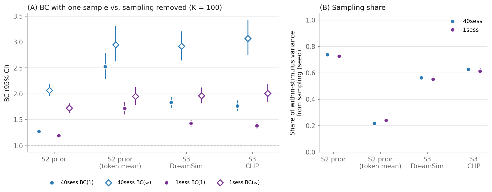

**予測の判定**

- **P1（S2 の全次元ではサンプリングの割合が 0.5 より大きく、トークン平均では小さい）: 支持。** 全次元 0.74・0.73、トークン平均 0.21・0.23（「小さい」の基準は計画になかったので、0.5 未満として判定した）
- **P2（S2 の全次元の BC(∞) は BC(1) よりはっきり大きい）: 支持**（40sess 1.27 → 2.04、1sess 1.20 → 1.74）。括弧の中の「Exp20 の全次元とトークン平均の差の多くはサンプリングで説明できる」は、測り方を計画で決めていなかったので、2 通りで示す（K = 1000）
  - 両方からサンプリングを除いて比べる: 差は 40sess で 1.157 → 0.764（縮んだ割合 0.34 [0.32, 0.36]）、1sess で 0.557 → 0.248（0.56 [0.52, 0.59]）
  - 全次元だけから除き、Exp20 のトークン平均の BC(1) と比べる: 差の 0.67 [0.65, 0.69]・0.97 [0.94, 1.01] を埋める
  - 同じ条件どうしの前者では、40sess の差の多くはサンプリングでは説明できない。括弧の中は**部分的にしか支持されない**
- **P3（S3 でも BC(∞) > BC(1)。40sess と 1sess の差は BC(∞) でも残る）: 支持。** BC(∞) の差は DreamSim +0.952 [+0.681, +1.228]、CLIP +1.061 [+0.753, +1.395]

**主要な発見**

- **1 枚の再構成画像では、同じ刺激の中のばらつきの半分以上が seed による**（S3 のサンプリングの割合 0.55〜0.63）。そのため BC(1) は、サンプリングを除いた BC の「1 を超えた分」の 0.37〜0.45 倍しかない（DreamSim で 40sess 1.84 → 2.92、1sess 1.43 → 1.97）。seed を 4 つ平均するだけでも 2.45・1.74 になる
- **サンプリングの割合は 40sess と 1sess で同じ**（S3 の差の CI は 0 を含む）。1sess の BC が低いのは、seed のばらつきが大きいからではなく、脳活動から来る刺激の違いが小さいため。割合が同じなので、BC − 1 の比（40sess / 1sess ≈ 2）は k によらずほぼ同じ
- **拡散 prior の全次元では、ばらつきの 74% が seed による。** Exp20 で S2 の全次元の BC が低かった（40sess、1,000 刺激で 1.273）のは、主にサンプリングのため。トークン平均は seed のばらつきの多くを平均で消している（割合 0.21）
- **予測にはなかった比較（探索的）:** S1（backbone、乱数を使わない）とサンプリングを除いた S2 を、同じ 256 × 1664 の形の出力で比べた（K = 1000、Exp20 と同じリサンプリングで paired）
  - トークン平均では、40sess は S1 とほぼ同じ（2.824 と 2.807、差 +0.017 [−0.074, +0.112]）だが、1sess は S2 の方が低い（2.441 と 1.991、差 +0.449 [+0.384, +0.517]）
  - 全次元では両モデルとも S2 の方が低い（S1 − S2 の BC(∞)：40sess +0.851 [+0.814, +0.888]、1sess +0.960 [+0.910, +1.009]）
  - 40sess では、prior でのトークン平均の BC の低下はサンプリングでほぼ説明できる。1sess では、prior がサンプリング以外でも刺激の違いを失っている（prior の分布に寄せている可能性）。backbone と prior の出力は形が同じでも分布が違うので、この比較は目安

**論文への示唆**: 拡散モデルの出力で BC を 1 回の生成だけから報告すると、脳から来る刺激の違いを大きく少なく見積もる。複数の seed で生成し、BC(1) と BC(∞)（またはサンプリングの割合）を併せて示すとよい。40sess と 1sess の比較は、BC(1) でも BC(∞) でも同じ結論になった。
